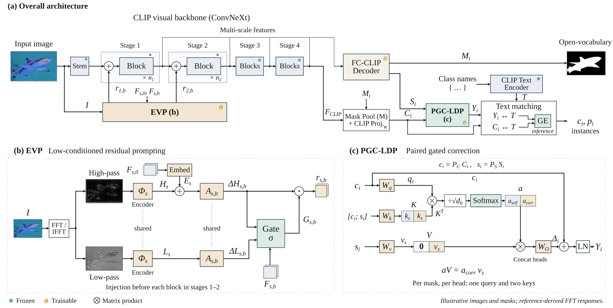

# OVS FCCLIP v11 图中组件说明

文字、图标、连线、张量与真实计算。

本文对应当前 v11 overview，逐项解释图上已经出现的内容。每个组件均区分外观、标注名称、抽象含义和代码中的实际作用；相同符号在不同位置有不同含义时分别注明。

核对版本为 3190e4cbd00f4957534df363f2c4e5ae11e787c9，采用仓库中的 PGC + 高低频 EVP、Stage 1–2 gated_add 完整配置。本文是图解与源码对照，不是一次模型推理或精度评估报告。 [S0](https://github.com/GU1204/OVS-FCCLIP/blob/3190e4cbd00f4957534df363f2c4e5ae11e787c9/docs/overview/OVS_FCCLIP_overview_v11.png) [S6](https://github.com/GU1204/OVS-FCCLIP/blob/3190e4cbd00f4957534df363f2c4e5ae11e787c9/configs/coco/panoptic-segmentation/fcclip/fcclip_convnext_base_waterovs_id_ldp_pgc_evp_high_low_router_stage12_gated_add_gb2_full.yaml) [S7](https://github.com/GU1204/OVS-FCCLIP/blob/3190e4cbd00f4957534df363f2c4e5ae11e787c9/configs/coco/panoptic-segmentation/fcclip/fcclip_convnext_base_waterovs_id.yaml)

阅读顺序：先看上方 (a) 的输入、共享主干、分割和分类路径；再看 (b) 如何给 Stage 1–2 注入提示；最后看 (c) 如何按每个 mask、每个 head 校正区域分类表示。

覆盖范围：118 条组件说明；108 处文字节点；61 条逻辑数据依赖；2 条参数共享标记。重复出现的文字逐处列入附录，重复类型的图标先按规则归组，再由组件与连线表定位。

| 查阅内容 | 所在章节 |
| --- | --- |
| C_i、c_i 和最终类别的区别 | 第一章 |
| 图标、颜色、边框、线条规则 | 第二章 |
| 上方总览及所有模块名称 | 第三章 |
| EVP 与 PGC 的每个局部元素 | 第四、五章 |
| 所有箭头和共享线的起止及真实作用 | 第六章 |
| 计算公式、尺寸、配置和省略项 | 第七、八章 |
| 逐字定位与固定版本源码 | 附录一、二 |

## 第一章 先区分这些符号

“Mask-pooled CLIP feature” 对应图中的大写 C_i，并且实际已通过冻结 CLIP 视觉投影。PGC 中的小写 c_i 还经过了另一层可训练投影，而最右侧输出的 c_i 表示类别标签。大小写和所在位置必须同时辨认。 [S1](https://github.com/GU1204/OVS-FCCLIP/blob/3190e4cbd00f4957534df363f2c4e5ae11e787c9/fcclip/modeling/backbone/clip.py) [S3](https://github.com/GU1204/OVS-FCCLIP/blob/3190e4cbd00f4957534df363f2c4e5ae11e787c9/fcclip/fcclip.py) [S5](https://github.com/GU1204/OVS-FCCLIP/blob/3190e4cbd00f4957534df363f2c4e5ae11e787c9/fcclip/modeling/local_discriminative_pooling.py)

| 图中标注与位置 | 推荐名称 | 真实含义 |
| --- | --- | --- |
| C_i｜总览池化模块之后 | Mask-pooled and CLIP-projected region feature 池化并经 CLIP 投影的区域特征 | 对 F_CLIP 使用预测 mask 做区域池化，再经冻结 CLIP visual heads；当前每个区域 640 维。 |
| c_i｜PGC 输入与顶部旁路 | Projected CLIP anchor token 投影后的 CLIP 锚点 | c_i=P_C(C_i)，P_C 为可训练仿射层；其旁路不乘 a_self。 |
| c_i｜最终 c_i,p_i 输出 | Predicted category label 预测类别标签 | 这是离散类别，与 PGC 的向量 c_i 重名；正文可把类别另记为 ℓ_i。 |
| S_i / s_i | Region structure feature / projected structure token | S_i 为 decoder 区域表示，当前 256 维；s_i=P_S(S_i) 为 640 维结构 token。 |
| T / K^T | Text embedding bank / transpose | 独立 T 为文本原型；K 的上标 T 是转置符号，与文本编码器无关。 |
| P_C / CLIP Proj. | Trainable anchor projection / frozen CLIP head | P_C 在 PGC 内；CLIP Proj. 在上方池化之后。两者位置、参数与训练状态均不同。 |
| p_i｜最终输出 | Instance confidence score 最终实例置信度 | 分类得分再乘 mask 前景区域的平均 sigmoid 概率，包含实例后处理。 |

本文保留图中的原标注。为避免混淆，描述最终结果时用“输出类别”或 ℓ_i，描述 PGC 残差时用“投影后锚点 c_i”；这只是本文解释方式，并未改动 PNG。以上区分可由池化、PGC 和实例推理三处实现核对。 [S3](https://github.com/GU1204/OVS-FCCLIP/blob/3190e4cbd00f4957534df363f2c4e5ae11e787c9/fcclip/fcclip.py) [S4](https://github.com/GU1204/OVS-FCCLIP/blob/3190e4cbd00f4957534df363f2c4e5ae11e787c9/fcclip/modeling/transformer_decoder/fcclip_transformer_decoder.py) [S5](https://github.com/GU1204/OVS-FCCLIP/blob/3190e4cbd00f4957534df363f2c4e5ae11e787c9/fcclip/modeling/local_discriminative_pooling.py)

## 第二章 图例与视觉规则

底色主要帮助识别来源和作用区域，雪花与火焰说明参数状态。不要把颜色、框形和可训练性建立一对一关系。 [S0](https://github.com/GU1204/OVS-FCCLIP/blob/3190e4cbd00f4957534df363f2c4e5ae11e787c9/docs/overview/OVS_FCCLIP_overview_v11.png) [S1](https://github.com/GU1204/OVS-FCCLIP/blob/3190e4cbd00f4957534df363f2c4e5ae11e787c9/fcclip/modeling/backbone/clip.py) [S2](https://github.com/GU1204/OVS-FCCLIP/blob/3190e4cbd00f4957534df363f2c4e5ae11e787c9/fcclip/modeling/backbone/evp_prompter.py) [S5](https://github.com/GU1204/OVS-FCCLIP/blob/3190e4cbd00f4957534df363f2c4e5ae11e787c9/fcclip/modeling/local_discriminative_pooling.py)

| 编号与图中标注 | 名称 | 视觉效果 | 抽象含义 | 真实作用与依据 |
| --- | --- | --- | --- | --- |
| **V01** (a) Overall architecture / (b) EVP / (c) PGC-LDP | Panel headings / 分图标题 | 黑色衬线字；分图字母和缩写加粗。 | 把同一个模型拆成总览与两个局部机制。 | (a)交代主数据流；(b)解释上方EVP；(c)解释上方PGC。字母是文内交叉引用，不是模型输入或运算。 [S0](https://github.com/GU1204/OVS-FCCLIP/blob/3190e4cbd00f4957534df363f2c4e5ae11e787c9/docs/overview/OVS_FCCLIP_overview_v11.png) |
| **V02** 字体 大小写 上下标 | Typography and indices / 字体与索引 | 正文近黑色；模块名正体，数学量多为斜体，小号上下标。 | 区分名称、张量与索引。 | 大小写有语义：C_i与c_i不同。s是stage，b是block，i是mask/query；K的上标T表示转置。排版自身不执行运算。 [S0](https://github.com/GU1204/OVS-FCCLIP/blob/3190e4cbd00f4957534df363f2c4e5ae11e787c9/docs/overview/OVS_FCCLIP_overview_v11.png) |
| **V03** 雪花 / Frozen | Frozen parameters / 冻结参数 | 蓝色枝状雪花共8处：Stem、4个stage块、CLIP投影、文本编码器、图例。 | 标记不更新的原始CLIP参数。 | requires_grad=False。冻结不等于特征不变或整个前向no_grad；EVP的梯度可穿过冻结主干运算。池化框内雪花主要指CLIP视觉head。 [S1](https://github.com/GU1204/OVS-FCCLIP/blob/3190e4cbd00f4957534df363f2c4e5ae11e787c9/fcclip/modeling/backbone/clip.py) |
| **V04** 火焰 / Trainable | Trainable parameters / 可训练参数 | 金色火焰共4处：EVP、Decoder、PGC、图例。 | 提示该模块含需要优化的参数。 | 图标是模块级概括；并非其每个内部操作都带参数。未绘火焰的下方Linear、Gate与LN也可属于可训练模块。 [S1](https://github.com/GU1204/OVS-FCCLIP/blob/3190e4cbd00f4957534df363f2c4e5ae11e787c9/fcclip/modeling/backbone/clip.py) [S2](https://github.com/GU1204/OVS-FCCLIP/blob/3190e4cbd00f4957534df363f2c4e5ae11e787c9/fcclip/modeling/backbone/evp_prompter.py) [S4](https://github.com/GU1204/OVS-FCCLIP/blob/3190e4cbd00f4957534df363f2c4e5ae11e787c9/fcclip/modeling/transformer_decoder/fcclip_transformer_decoder.py) [S5](https://github.com/GU1204/OVS-FCCLIP/blob/3190e4cbd00f4957534df363f2c4e5ae11e787c9/fcclip/modeling/local_discriminative_pooling.py) |
| **V05** 圆圈内 + | Elementwise addition / 逐元素加法 | 白底细边圆内正交加号，共4处。 | 把兼容形状的特征相加。 | 分别为Stage1/2的F+r、EVP的H+E、PGC的c+Δ；不是拼接。Stage1/2中的该单元会随block重复。 [S1](https://github.com/GU1204/OVS-FCCLIP/blob/3190e4cbd00f4957534df363f2c4e5ae11e787c9/fcclip/modeling/backbone/clip.py) [S2](https://github.com/GU1204/OVS-FCCLIP/blob/3190e4cbd00f4957534df363f2c4e5ae11e787c9/fcclip/modeling/backbone/evp_prompter.py) [S5](https://github.com/GU1204/OVS-FCCLIP/blob/3190e4cbd00f4957534df363f2c4e5ae11e787c9/fcclip/modeling/local_discriminative_pooling.py) |
| **V06** 圆圈内 × / Matrix product | Matrix multiplication / 矩阵乘法 | 白底圆内斜叉；PGC两处，底部图例一处。 | 先计算注意力分数，再按权重聚合value。 | 第一次是qK^T，第二次是aV。第二次在实现中利用V=[0,v_s]简化为a_corr乘v_s，与EVP点乘语义不同。 [S5](https://github.com/GU1204/OVS-FCCLIP/blob/3190e4cbd00f4957534df363f2c4e5ae11e787c9/fcclip/modeling/local_discriminative_pooling.py) |
| **V07** 圆圈内实心点 | Hadamard multiplication / 逐元素乘法 | EVP右端白圆内一个小点，共1处。 | 用空间门控缩放候选残差。 | r_{s,b}=G_{s,b}⊙ΔH_{s,b}；G为单通道空间图，沿特征通道广播。 [S2](https://github.com/GU1204/OVS-FCCLIP/blob/3190e4cbd00f4957534df363f2c4e5ae11e787c9/fcclip/modeling/backbone/evp_prompter.py) |
| **V08** 无外圈黑点 | Branch junction / 分叉节点 | 小黑实心圆共9处。 | 一份数据被送往多个后续路径。 | 4个stage输出tap，图像分支、C_i分支、频率分支、ΔH分支、PGC的c_i残差分支。不是乘法，也不新增参数。 [S0](https://github.com/GU1204/OVS-FCCLIP/blob/3190e4cbd00f4957534df363f2c4e5ae11e787c9/docs/overview/OVS_FCCLIP_overview_v11.png) [S1](https://github.com/GU1204/OVS-FCCLIP/blob/3190e4cbd00f4957534df363f2c4e5ae11e787c9/fcclip/modeling/backbone/clip.py) [S2](https://github.com/GU1204/OVS-FCCLIP/blob/3190e4cbd00f4957534df363f2c4e5ae11e787c9/fcclip/modeling/backbone/evp_prompter.py) [S3](https://github.com/GU1204/OVS-FCCLIP/blob/3190e4cbd00f4957534df363f2c4e5ae11e787c9/fcclip/fcclip.py) [S5](https://github.com/GU1204/OVS-FCCLIP/blob/3190e4cbd00f4957534df363f2c4e5ae11e787c9/fcclip/modeling/local_discriminative_pooling.py) |
| **V09** 黑色实线箭头 | Forward data flow / 前向数据流 | 水平或直角折线，末端实心箭头。 | 箭头方向表示数据依赖。 | 不是时间轴、反向传播或监督。长短和折角只服务排版；完整61条逻辑依赖见连线清单。 [S0](https://github.com/GU1204/OVS-FCCLIP/blob/3190e4cbd00f4957534df363f2c4e5ae11e787c9/docs/overview/OVS_FCCLIP_overview_v11.png) |
| **V10** 细灰多尺度连线 | Multi-scale feature collection / 多尺度特征集合 | 4个stage后竖线接上方横线，只在decoder入口显示箭头。 | 把不同分辨率的stage输出组织成集合。 | 对应res2、res3、res4、res5送入解码路径；连线汇合不表示把这些张量直接逐元素求和。 [S1](https://github.com/GU1204/OVS-FCCLIP/blob/3190e4cbd00f4957534df363f2c4e5ae11e787c9/fcclip/modeling/backbone/clip.py) [S4](https://github.com/GU1204/OVS-FCCLIP/blob/3190e4cbd00f4957534df363f2c4e5ae11e787c9/fcclip/modeling/transformer_decoder/fcclip_transformer_decoder.py) |
| **V11** shared旁的竖向虚线 | Weight-sharing annotation / 参数共享注释 | EVP有两条细灰虚线，各连接上下同类模块。 | 两次调用复用同一组对应权重。 | 左边只连接Φ_s高低频两路；右边只连接固定s,b的A_{s,b}两路。虚线没有数据流，两个shared也不表示Φ与A互相共享。 [S2](https://github.com/GU1204/OVS-FCCLIP/blob/3190e4cbd00f4957534df363f2c4e5ae11e787c9/fcclip/modeling/backbone/evp_prompter.py) |
| **V12** 下方两个大虚线框 | Detail-panel boundary / 局部解释边界 | 浅灰#C6CDD2虚线矩形，白底无圆角。 | 划分EVP和PGC局部计算图。 | 只用于分区；不是模型层、训练区域、loss边界或执行循环。 [S0](https://github.com/GU1204/OVS-FCCLIP/blob/3190e4cbd00f4957534df363f2c4e5ae11e787c9/docs/overview/OVS_FCCLIP_overview_v11.png) |
| **V13** Stage1/2内重复框 | Repeated computation unit / 重复计算单元 | 浅灰白#FAFBFC底，细实线框，内部含加法和Block。 | 框内计算按对应stage深度重复。 | ×n_s同时覆盖加法与block。stage下采样未画在重复框内，也不会跟着n_s重复执行。 [S1](https://github.com/GU1204/OVS-FCCLIP/blob/3190e4cbd00f4957534df363f2c4e5ae11e787c9/fcclip/modeling/backbone/clip.py) |
| **V14** 浅蓝色矩形 | CLIP-side visual coding / CLIP侧视觉编码 | 主要填充#E7EDF3，用于主干、文本编码器和部分张量槽。 | 强调原有CLIP分支或该分支派生的数据。 | 颜色并不自动等于冻结：k_c和a_self由可训练PGC运算产生，蓝色仅区分self/CLIP候选。是否可训练须看代码和图标。 [S0](https://github.com/GU1204/OVS-FCCLIP/blob/3190e4cbd00f4957534df363f2c4e5ae11e787c9/docs/overview/OVS_FCCLIP_overview_v11.png) [S1](https://github.com/GU1204/OVS-FCCLIP/blob/3190e4cbd00f4957534df363f2c4e5ae11e787c9/fcclip/modeling/backbone/clip.py) [S5](https://github.com/GU1204/OVS-FCCLIP/blob/3190e4cbd00f4957534df363f2c4e5ae11e787c9/fcclip/modeling/local_discriminative_pooling.py) |
| **V15** 浅金色矩形 | Prompt or structure-side coding / 提示或结构侧编码 | 主要填充#F3E7D3，用于EVP、投影、adapter、结构槽和残差叠片。 | 强调提示生成、结构候选或新增映射。 | 有的金框是含参数层，有的是数据容器；金色v_s、k_s和残差不是独立参数表。Decoder另用浅米色#F5F1E9。 [S0](https://github.com/GU1204/OVS-FCCLIP/blob/3190e4cbd00f4957534df363f2c4e5ae11e787c9/docs/overview/OVS_FCCLIP_overview_v11.png) [S2](https://github.com/GU1204/OVS-FCCLIP/blob/3190e4cbd00f4957534df363f2c4e5ae11e787c9/fcclip/modeling/backbone/evp_prompter.py) [S5](https://github.com/GU1204/OVS-FCCLIP/blob/3190e4cbd00f4957534df363f2c4e5ae11e787c9/fcclip/modeling/local_discriminative_pooling.py) |
| **V16** 浅青绿色矩形 | Fusion and attention coding / 融合与注意力编码 | 填充#DCEBE5，用于Gate、PGC、Softmax、GE。 | 在版面上突出门控、校正及融合位置。 | Gate和PGC有可训练参数；Softmax无学习参数，GE权重来自固定配置。青绿色本身不是统一的训练状态标记。 [S2](https://github.com/GU1204/OVS-FCCLIP/blob/3190e4cbd00f4957534df363f2c4e5ae11e787c9/fcclip/modeling/backbone/evp_prompter.py) [S3](https://github.com/GU1204/OVS-FCCLIP/blob/3190e4cbd00f4957534df363f2c4e5ae11e787c9/fcclip/fcclip.py) [S5](https://github.com/GU1204/OVS-FCCLIP/blob/3190e4cbd00f4957534df363f2c4e5ae11e787c9/fcclip/modeling/local_discriminative_pooling.py) |
| **V17** 白底运算框与细边框 | Operator and container boxes / 运算或容器框 | 白底，深灰蓝#334353细边，如FFT、缩放、LN和匹配框。 | 界定一个操作或一组相关操作。 | 白底不等于冻结；LN含可训练仿射参数。模块边框与示例图像边框只是视觉边界。 [S0](https://github.com/GU1204/OVS-FCCLIP/blob/3190e4cbd00f4957534df363f2c4e5ae11e787c9/docs/overview/OVS_FCCLIP_overview_v11.png) [S2](https://github.com/GU1204/OVS-FCCLIP/blob/3190e4cbd00f4957534df363f2c4e5ae11e787c9/fcclip/modeling/backbone/evp_prompter.py) [S5](https://github.com/GU1204/OVS-FCCLIP/blob/3190e4cbd00f4957534df363f2c4e5ae11e787c9/fcclip/modeling/local_discriminative_pooling.py) |
| **V18** 双片叠放矩形 | Feature tensor glyph / 特征张量图标 | 3组，每组2片错位矩形：F_{s,0}、F_{s,b}蓝色，r_{s,b}金色。 | 表示多通道空间特征或残差张量。 | 两片是示意画法，不等于2通道、2个head、2层网络或两个独立样本。 [S0](https://github.com/GU1204/OVS-FCCLIP/blob/3190e4cbd00f4957534df363f2c4e5ae11e787c9/docs/overview/OVS_FCCLIP_overview_v11.png) [S2](https://github.com/GU1204/OVS-FCCLIP/blob/3190e4cbd00f4957534df363f2c4e5ae11e787c9/fcclip/modeling/backbone/evp_prompter.py) |
| **V19** K a V的双格容器 | Two-slot tensor / 两候选张量容器 | 每个容器有相邻两格，依次为self和structure/correction。 | 为同一个mask的两个候选保留顺序。 | K=[k_c,k_s]；a=[a_self,a_corr]；V=[0,v_s]。线接到容器左缘表示传入整体，不表示把v_s先送入0槽。 [S5](https://github.com/GU1204/OVS-FCCLIP/blob/3190e4cbd00f4957534df363f2c4e5ae11e787c9/fcclip/modeling/local_discriminative_pooling.py) |
| **V20** 两处彩色输入图 | Input-image illustration / 输入图像示例 | (a)左侧与(b)左侧是同一鱼类参考图的两个显示实例。 | 分别定位整体输入与频率分支输入。 | 两图不是两次独立采集或两个编码器。素材来自用户参考图；实际运行会先按CLIP均值/方差归一化并做batch padding。 [S0](https://github.com/GU1204/OVS-FCCLIP/blob/3190e4cbd00f4957534df363f2c4e5ae11e787c9/docs/overview/OVS_FCCLIP_overview_v11.png) [S3](https://github.com/GU1204/OVS-FCCLIP/blob/3190e4cbd00f4957534df363f2c4e5ae11e787c9/fcclip/fcclip.py) |
| **V21** 两张灰度频率小图 | Reference-derived FFT responses / 参考图的频率响应示例 | 上方High-pass偏黑且保留细节，下方Low-pass灰色且结构平滑。 | 形象提示高低频内容差异。 | 由参考裁图按FFT算子计算，再对显示强度缩放；不是学习后的Φ特征、Gate激活或实际推理结果。 [S0](https://github.com/GU1204/OVS-FCCLIP/blob/3190e4cbd00f4957534df363f2c4e5ae11e787c9/docs/overview/OVS_FCCLIP_overview_v11.png) [S2](https://github.com/GU1204/OVS-FCCLIP/blob/3190e4cbd00f4957534df363f2c4e5ae11e787c9/fcclip/modeling/backbone/evp_prompter.py) |
| **V22** 黑底白色鱼形图 | Illustrative mask / 掩码示例 | (a)右上黑底白色轮廓。 | 示意M_i的前景空间区域。 | 图上角色是预测mask。素材取自用户参考图中的mask裁图，用作展示，不代表本模型已产生该结果，也不是本图的GT输入。 [S0](https://github.com/GU1204/OVS-FCCLIP/blob/3190e4cbd00f4957534df363f2c4e5ae11e787c9/docs/overview/OVS_FCCLIP_overview_v11.png) |
| **V23** Illustrative images and masks; reference-derived FFT responses. | Illustration provenance note / 示例来源说明 | 页脚右侧黑色斜体小字。 | 限定图中照片、mask和灰度响应的证据属性。 | 明确这些用于解释机制，不能据此判断分割精度或训练后的响应强度。 [S0](https://github.com/GU1204/OVS-FCCLIP/blob/3190e4cbd00f4957534df363f2c4e5ae11e787c9/docs/overview/OVS_FCCLIP_overview_v11.png) |
| **V24** M_i及F_{s,0},F_{s,b}的短入口 | Named tensor input / 同名张量入口 | 变量名下方一段短箭头，未画完整跨区域回接线。 | 同一名字引用已有张量。 | pooling的M_i来自decoder；EVP的F_{s,0},F_{s,b}来自主干阶段入口和当前block。省略长线不表示额外独立来源。 [S1](https://github.com/GU1204/OVS-FCCLIP/blob/3190e4cbd00f4957534df363f2c4e5ae11e787c9/fcclip/modeling/backbone/clip.py) [S2](https://github.com/GU1204/OVS-FCCLIP/blob/3190e4cbd00f4957534df363f2c4e5ae11e787c9/fcclip/modeling/backbone/evp_prompter.py) [S3](https://github.com/GU1204/OVS-FCCLIP/blob/3190e4cbd00f4957534df363f2c4e5ae11e787c9/fcclip/fcclip.py) |
| **V25** × n / + CLIP Proj. / ↔ | Context-dependent symbols / 随语境区分的记号 | 分别是框角文字、模块名连接词和匹配框内符号。 | 重复、顺序组合、相似度匹配三种不同语义。 | ×n不是矩阵乘；名称中的+表示pool后接projection，不是特征相加；↔不是双向数据流或cross-attention。 [S0](https://github.com/GU1204/OVS-FCCLIP/blob/3190e4cbd00f4957534df363f2c4e5ae11e787c9/docs/overview/OVS_FCCLIP_overview_v11.png) [S3](https://github.com/GU1204/OVS-FCCLIP/blob/3190e4cbd00f4957534df363f2c4e5ae11e787c9/fcclip/fcclip.py) [S4](https://github.com/GU1204/OVS-FCCLIP/blob/3190e4cbd00f4957534df363f2c4e5ae11e787c9/fcclip/modeling/transformer_decoder/fcclip_transformer_decoder.py) |

### 视觉参数与重复元素

| 项目 | 画法或数量 | 含义与边界 |
| --- | --- | --- |
| 画布与排版 | 白底；6000 × 3015 PNG；底稿坐标 2000 × 1005 | 纯白画布不代表一个网络操作。衬线字体为 Liberation Serif / Times New Roman 风格。 |
| 主数据线 | 近黑 #151719；常规宽约 2.2 底稿单位 | 实心三角箭头决定方向；折线长度不编码时间、权重或计算量。 |
| 辅助线与模块边界 | 辅助线约 1.5–1.8 单位；边框 #334353 | 细线降低视觉权重，不代表低置信度或梯度被截断。 |
| 四种模块底色 | 蓝 #E7EDF3；金 #F3E7D3；青绿 #DCEBE5；decoder 米色 #F5F1E9 | 辅助分组；具体计算与参数状态以组件说明为准。 |
| 共享注释 | 灰色 #899095 虚线；shared 背后有白色遮底 | 白底仅防止线穿过文字，不是新增模块。 |
| 雪花与火焰 | 雪花 8；火焰 4，均含图例 | 同一类标记在不同模块复用；图例自身不参与计算。 |
| 运算与分支 | 圆加号 4；圆叉号 3；圆点乘 1；实心分支点 9 | 圆叉号总数包含图例一处，其余两处在 PGC。 |
| 张量与图像 | 特征叠片 3 组；K/a/V 双格容器 3 组；栅格图 5 张 | 5 张图为两张输入示意、两张频率响应、一张 mask 示意。 |
| 矩形图元覆盖 | 模块框 26；总矩形 50 | 其余为双格、框架、叠片、图像边界、shared 白底和背景；它们不各自对应模型层。 |
| 线条图元覆盖 | 底层路径 113；箭头路径 63 | 有 6 条是同一路线被背景覆盖后重绘；按 61 条逻辑依赖解释，不能从绘图路径数推断计算次数。 |

本节的外观、颜色与数量来自原图及其绘图清单。它们用于复现视觉规则，不是训练超参数。 [S0](https://github.com/GU1204/OVS-FCCLIP/blob/3190e4cbd00f4957534df363f2c4e5ae11e787c9/docs/overview/OVS_FCCLIP_overview_v11.png)

## 第三章 上方总览的全部组件

上方包含一套共享 CLIP ConvNeXt 视觉主干。它同时提供分割所需的多尺度特征，以及区域 CLIP 特征的池化来源；EVP 注入改变激活，PGC 校正区域分类表示，GE 合并两条分类分支。 [S1](https://github.com/GU1204/OVS-FCCLIP/blob/3190e4cbd00f4957534df363f2c4e5ae11e787c9/fcclip/modeling/backbone/clip.py) [S3](https://github.com/GU1204/OVS-FCCLIP/blob/3190e4cbd00f4957534df363f2c4e5ae11e787c9/fcclip/fcclip.py) [S5](https://github.com/GU1204/OVS-FCCLIP/blob/3190e4cbd00f4957534df363f2c4e5ae11e787c9/fcclip/modeling/local_discriminative_pooling.py)

| 编号与图中标注 | 名称 | 视觉效果 | 抽象含义 | 真实作用与依据 |
| --- | --- | --- | --- | --- |
| **A01** Input image / I | Input image / 输入图像 | 左侧彩色示例；分一路到Stem，另一路到EVP。 | 同一张图像的视觉内容。 | 真实输入先做CLIP归一化和padding；主干与EVP高低频提取都接收相应的归一化张量。I在(b)重复显示是局部展开。 [S3](https://github.com/GU1204/OVS-FCCLIP/blob/3190e4cbd00f4957534df363f2c4e5ae11e787c9/fcclip/fcclip.py) |
| **A02** CLIP visual backbone (ConvNeXt) | CLIP-pretrained ConvNeXt visual backbone / CLIP视觉主干 | 位于Stage1–4上方的总标题。 | 共享的层级卷积视觉编码器。 | 一套主干前向同时为decoder与CLIP区域分类供特征；原CLIP权重冻结，可训练EVP改变其中间特征。 [S1](https://github.com/GU1204/OVS-FCCLIP/blob/3190e4cbd00f4957534df363f2c4e5ae11e787c9/fcclip/modeling/backbone/clip.py) |
| **A03** Stem | ConvNeXt stem / 主干入口映射 | 第一块浅蓝矩形，带雪花。 | 把图像转成初始空间特征。 | 执行visual.trunk.stem，再进入四级stages；不是文本tokenizer。图未拆出内部卷积和归一化。 [S1](https://github.com/GU1204/OVS-FCCLIP/blob/3190e4cbd00f4957534df363f2c4e5ae11e787c9/fcclip/modeling/backbone/clip.py) |
| **A04** Stage 1 | First ConvNeXt stage / 第一阶段 | 第一个带加法与Block的重复框。 | 第一组层级特征处理。 | 该配置在此启用EVP：stage入口生成一次embedding提示，每个block前重新得到门控残差并相加；输出res2。 [S1](https://github.com/GU1204/OVS-FCCLIP/blob/3190e4cbd00f4957534df363f2c4e5ae11e787c9/fcclip/modeling/backbone/clip.py) [S6](https://github.com/GU1204/OVS-FCCLIP/blob/3190e4cbd00f4957534df363f2c4e5ae11e787c9/configs/coco/panoptic-segmentation/fcclip/fcclip_convnext_base_waterovs_id_ldp_pgc_evp_high_low_router_stage12_gated_add_gb2_full.yaml) |
| **A05** Stage 2 | Second ConvNeXt stage / 第二阶段 | 第二个带加法与Block的重复框。 | 第二组层级特征处理。 | 先执行该stage的downsample，再按block注入EVP；输出res3。图中的r_{2,b}只对应这一stage。 [S1](https://github.com/GU1204/OVS-FCCLIP/blob/3190e4cbd00f4957534df363f2c4e5ae11e787c9/fcclip/modeling/backbone/clip.py) [S6](https://github.com/GU1204/OVS-FCCLIP/blob/3190e4cbd00f4957534df363f2c4e5ae11e787c9/configs/coco/panoptic-segmentation/fcclip/fcclip_convnext_base_waterovs_id_ldp_pgc_evp_high_low_router_stage12_gated_add_gb2_full.yaml) |
| **A06** Stage 3 | Third ConvNeXt stage / 第三阶段 | 第三个浅蓝Blocks矩形。 | 进一步提取较低分辨率特征。 | 所选配置在本stage不注入EVP，按原stage整体前向，输出res4。 [S1](https://github.com/GU1204/OVS-FCCLIP/blob/3190e4cbd00f4957534df363f2c4e5ae11e787c9/fcclip/modeling/backbone/clip.py) [S6](https://github.com/GU1204/OVS-FCCLIP/blob/3190e4cbd00f4957534df363f2c4e5ae11e787c9/configs/coco/panoptic-segmentation/fcclip/fcclip_convnext_base_waterovs_id_ldp_pgc_evp_high_low_router_stage12_gated_add_gb2_full.yaml) |
| **A07** Stage 4 | Fourth ConvNeXt stage / 第四阶段 | 最右侧浅蓝Blocks矩形。 | 最终层级特征。 | 该配置无EVP注入，输出res5；之后norm_pre得到另一路F_CLIP。res5与F_CLIP有这一步区别。 [S1](https://github.com/GU1204/OVS-FCCLIP/blob/3190e4cbd00f4957534df363f2c4e5ae11e787c9/fcclip/modeling/backbone/clip.py) [S6](https://github.com/GU1204/OVS-FCCLIP/blob/3190e4cbd00f4957534df363f2c4e5ae11e787c9/configs/coco/panoptic-segmentation/fcclip/fcclip_convnext_base_waterovs_id_ldp_pgc_evp_high_low_router_stage12_gated_add_gb2_full.yaml) |
| **A08** Block | Frozen ConvNeXt block / 冻结ConvNeXt块 | Stage1、2重复框中各一块浅蓝矩形。 | 一个需要重复执行的原主干block。 | 接收F_{s,b}+r_{s,b}，而不是把r加在block输出端；内部卷积与残差结构在overview中省略。 [S1](https://github.com/GU1204/OVS-FCCLIP/blob/3190e4cbd00f4957534df363f2c4e5ae11e787c9/fcclip/modeling/backbone/clip.py) |
| **A09** Blocks | Unexpanded ConvNeXt blocks / 未展开的多个块 | Stage3、4中的复数标签。 | 用一个框概括stage内多个block。 | 不是一个新算子；所选配置沿原stage路径执行其下采样和blocks。 [S1](https://github.com/GU1204/OVS-FCCLIP/blob/3190e4cbd00f4957534df363f2c4e5ae11e787c9/fcclip/modeling/backbone/clip.py) |
| **A10** × n_1 / × n_2 | Block repetition count / 阶段内block数 | 两个重复框右下角的小号文字。 | 分别重复第一、第二stage内的加法→Block单元。 | n_s从已加载主干的stage.blocks长度取得；不是attention head数，也不代表重复stage下采样。 [S1](https://github.com/GU1204/OVS-FCCLIP/blob/3190e4cbd00f4957534df363f2c4e5ae11e787c9/fcclip/modeling/backbone/clip.py) |
| **A11** EVP (b) | Explicit Visual Prompting / 显式视觉提示 | Stage1–2下方的浅金色长框，带火焰。 | 按图像内容及主干状态生成残差提示。 | 此图选择高低频、低频条件空间门控、Stage1–2逐block注入的EVP配置；(b)指向下方内部展开。 [S1](https://github.com/GU1204/OVS-FCCLIP/blob/3190e4cbd00f4957534df363f2c4e5ae11e787c9/fcclip/modeling/backbone/clip.py) [S2](https://github.com/GU1204/OVS-FCCLIP/blob/3190e4cbd00f4957534df363f2c4e5ae11e787c9/fcclip/modeling/backbone/evp_prompter.py) [S6](https://github.com/GU1204/OVS-FCCLIP/blob/3190e4cbd00f4957534df363f2c4e5ae11e787c9/configs/coco/panoptic-segmentation/fcclip/fcclip_convnext_base_waterovs_id_ldp_pgc_evp_high_low_router_stage12_gated_add_gb2_full.yaml) |
| **A12** r_{1,b} / r_{2,b} | Per-block prompt residual / 逐块提示残差 | EVP向上的两条线旁标签。 | 第1或第2stage的第b个block要注入的增量。 | 等于该block的Gate输出乘高频与embedding适配后的候选残差；对应stage的加法节点接收它。 [S1](https://github.com/GU1204/OVS-FCCLIP/blob/3190e4cbd00f4957534df363f2c4e5ae11e787c9/fcclip/modeling/backbone/clip.py) [S2](https://github.com/GU1204/OVS-FCCLIP/blob/3190e4cbd00f4957534df363f2c4e5ae11e787c9/fcclip/modeling/backbone/evp_prompter.py) |
| **A13** F_{s,0}, F_{s,b} | Stage-entry and current-block features / 阶段入口与当前块特征 | EVP上方两条残差线之间的同名入口。 | 为embedding提示和当前门控提供不同状态。 | F_{s,0}在stage下采样后取得并生成一次E_s；F_{s,b}每个block更新，用于Gate。下标b不是batch。 [S1](https://github.com/GU1204/OVS-FCCLIP/blob/3190e4cbd00f4957534df363f2c4e5ae11e787c9/fcclip/modeling/backbone/clip.py) [S2](https://github.com/GU1204/OVS-FCCLIP/blob/3190e4cbd00f4957534df363f2c4e5ae11e787c9/fcclip/modeling/backbone/evp_prompter.py) |
| **A14** Multi-scale features | Multi-scale stage features / 多尺度阶段特征 | 四个stage输出tap汇到上方细线。 | 保留多个空间尺度的信息。 | 对应res2…res5，配置的输出步长为4、8、16、32；decoder自行处理尺度变换，图中总线不是直接求和。 [S1](https://github.com/GU1204/OVS-FCCLIP/blob/3190e4cbd00f4957534df363f2c4e5ae11e787c9/fcclip/modeling/backbone/clip.py) [S4](https://github.com/GU1204/OVS-FCCLIP/blob/3190e4cbd00f4957534df363f2c4e5ae11e787c9/fcclip/modeling/transformer_decoder/fcclip_transformer_decoder.py) |
| **A15** F_CLIP | Dense CLIP visual feature map / 密集CLIP视觉特征图 | 最后一级向下再向右的支路。 | 可按空间mask提取区域表示的CLIP特征场。 | 由Stage4输出经norm_pre得到clip_vis_dense；不是整图global embedding，也不是已经mask pooling的C_i。 [S1](https://github.com/GU1204/OVS-FCCLIP/blob/3190e4cbd00f4957534df363f2c4e5ae11e787c9/fcclip/modeling/backbone/clip.py) [S3](https://github.com/GU1204/OVS-FCCLIP/blob/3190e4cbd00f4957534df363f2c4e5ae11e787c9/fcclip/fcclip.py) |
| **A16** FC-CLIP Decoder | FC-CLIP segmentation decoder / FC-CLIP分割解码路径 | 浅米色两行矩形，带火焰。 | 由多尺度主干特征产生mask和区域结构信息。 | 这里概括pixel decoder与transformer/mask decoder。pred_masks提供M，pred_region_features提供S；图未展示所有内部查询与辅助预测。 [S3](https://github.com/GU1204/OVS-FCCLIP/blob/3190e4cbd00f4957534df363f2c4e5ae11e787c9/fcclip/fcclip.py) [S4](https://github.com/GU1204/OVS-FCCLIP/blob/3190e4cbd00f4957534df363f2c4e5ae11e787c9/fcclip/modeling/transformer_decoder/fcclip_transformer_decoder.py) |
| **A17** M_i | Predicted mask for query i / 第i个查询的预测掩码 | decoder输出线上和pooling短入口处各标一次。 | 第i个区域的空间支持。 | 内部pred_masks首先是mask logits。pooling时先插值并以>0硬二值化；输出图只是显示mask形态。两处M_i是同一预测来源。 [S3](https://github.com/GU1204/OVS-FCCLIP/blob/3190e4cbd00f4957534df363f2c4e5ae11e787c9/fcclip/fcclip.py) [S4](https://github.com/GU1204/OVS-FCCLIP/blob/3190e4cbd00f4957534df363f2c4e5ae11e787c9/fcclip/modeling/transformer_decoder/fcclip_transformer_decoder.py) |
| **A18** Mask Pool (M) | Mask pooling with predicted masks / 预测掩码池化 | 白色模块上半行。 | 把区域内密集特征汇成一个向量。 | MaskPooling把resize后的mask logits>0转为二值支持，按像素数归一化后求特征均值；mask在此detach。不是soft-sigmoid加权池化。 [S3](https://github.com/GU1204/OVS-FCCLIP/blob/3190e4cbd00f4957534df363f2c4e5ae11e787c9/fcclip/fcclip.py) [S4](https://github.com/GU1204/OVS-FCCLIP/blob/3190e4cbd00f4957534df363f2c4e5ae11e787c9/fcclip/modeling/transformer_decoder/fcclip_transformer_decoder.py) |
| **A19** + CLIP Proj. | Frozen CLIP visual projection heads / 冻结CLIP视觉投影头 | 池化模块下半行，右下角雪花。 | 把区域均值特征送到CLIP对齐的嵌入空间。 | ConvNeXt路径依次调用trunk.head与visual.head。名称中的+表示后接这一步；它不同于PGC里可训练且identity初始化的P_C。 [S1](https://github.com/GU1204/OVS-FCCLIP/blob/3190e4cbd00f4957534df363f2c4e5ae11e787c9/fcclip/modeling/backbone/clip.py) [S3](https://github.com/GU1204/OVS-FCCLIP/blob/3190e4cbd00f4957534df363f2c4e5ae11e787c9/fcclip/fcclip.py) |
| **A20** C_i | Mask-pooled and CLIP-projected region feature / 池化并经CLIP投影的区域特征 | 池化模块输出的斜体大写C_i；一分为二。 | 与第i个mask配对的CLIP语义锚点。 | 来自F_CLIP在M_i内的区域均值，再经冻结CLIP视觉heads。送入PGC，并独立用于C_i↔T分支；本配置为640维。 [S1](https://github.com/GU1204/OVS-FCCLIP/blob/3190e4cbd00f4957534df363f2c4e5ae11e787c9/fcclip/modeling/backbone/clip.py) [S3](https://github.com/GU1204/OVS-FCCLIP/blob/3190e4cbd00f4957534df363f2c4e5ae11e787c9/fcclip/fcclip.py) [S4](https://github.com/GU1204/OVS-FCCLIP/blob/3190e4cbd00f4957534df363f2c4e5ae11e787c9/fcclip/modeling/transformer_decoder/fcclip_transformer_decoder.py) [S7](https://github.com/GU1204/OVS-FCCLIP/blob/3190e4cbd00f4957534df363f2c4e5ae11e787c9/configs/coco/panoptic-segmentation/fcclip/fcclip_convnext_base_waterovs_id.yaml) |
| **A21** S_i | Decoder-derived region structure feature / 解码器区域结构特征 | decoder折线输出至PGC上方入口。 | 与同一mask配对的可训练结构表示。 | S_i=Linear(LN(MaskPool(pixel features,M_i)))+decoder_norm(query_i)。本配置为256维；它包含池化区域信息与查询表示，不是mask位图。 [S4](https://github.com/GU1204/OVS-FCCLIP/blob/3190e4cbd00f4957534df363f2c4e5ae11e787c9/fcclip/modeling/transformer_decoder/fcclip_transformer_decoder.py) [S7](https://github.com/GU1204/OVS-FCCLIP/blob/3190e4cbd00f4957534df363f2c4e5ae11e787c9/configs/coco/panoptic-segmentation/fcclip/fcclip_convnext_base_waterovs_id.yaml) |
| **A22** PGC-LDP (c) | Paired Gated Correction in the LDP slot / LDP接口中的配对门控校正 | 浅青绿矩形，带火焰，第二行(c)。 | 用结构信息校正CLIP区域锚点。 | 配置TYPE=paired_gated_correction，调用PairedGatedCorrection。LDP是接口/模块家族名，不表示先运行另一个LDP再运行PGC。 [S3](https://github.com/GU1204/OVS-FCCLIP/blob/3190e4cbd00f4957534df363f2c4e5ae11e787c9/fcclip/fcclip.py) [S5](https://github.com/GU1204/OVS-FCCLIP/blob/3190e4cbd00f4957534df363f2c4e5ae11e787c9/fcclip/modeling/local_discriminative_pooling.py) [S6](https://github.com/GU1204/OVS-FCCLIP/blob/3190e4cbd00f4957534df363f2c4e5ae11e787c9/configs/coco/panoptic-segmentation/fcclip/fcclip_convnext_base_waterovs_id_ldp_pgc_evp_high_low_router_stage12_gated_add_gb2_full.yaml) |
| **A23** Y_i | PGC-corrected region embedding / PGC校正后的区域嵌入 | PGC至Text matching的短输出箭头。 | 用于分类匹配的新区域语义表示。 | 经过配对注意力校正、输出投影、与投影锚点残差相加及LN；不用于重新生成或细化M_i。本配置640维。 [S3](https://github.com/GU1204/OVS-FCCLIP/blob/3190e4cbd00f4957534df363f2c4e5ae11e787c9/fcclip/fcclip.py) [S5](https://github.com/GU1204/OVS-FCCLIP/blob/3190e4cbd00f4957534df363f2c4e5ae11e787c9/fcclip/modeling/local_discriminative_pooling.py) [S7](https://github.com/GU1204/OVS-FCCLIP/blob/3190e4cbd00f4957534df363f2c4e5ae11e787c9/configs/coco/panoptic-segmentation/fcclip/fcclip_convnext_base_waterovs_id.yaml) |
| **A24** Class names / { … } | Candidate class-name set / 候选类别名称集合 | 文字与花括号省略号，输入文本编码器。 | 本次识别的开放词汇候选集合。 | 类别名及同义词从metadata读取，填入VILD_PROMPT模板；{…}是集合占位，不是实际词表或无限类别同时预测。 [S3](https://github.com/GU1204/OVS-FCCLIP/blob/3190e4cbd00f4957534df363f2c4e5ae11e787c9/fcclip/fcclip.py) |
| **A25** CLIP Text Encoder | Frozen CLIP text encoder / 冻结CLIP文本编码器 | 浅蓝两行矩形，带雪花。 | 将候选类别文本映射为可比较的语义向量。 | 对模板化文本编码并归一化，模板均值后再归一化并缓存；不是可训练文本prompt分支。 [S1](https://github.com/GU1204/OVS-FCCLIP/blob/3190e4cbd00f4957534df363f2c4e5ae11e787c9/fcclip/modeling/backbone/clip.py) [S3](https://github.com/GU1204/OVS-FCCLIP/blob/3190e4cbd00f4957534df363f2c4e5ae11e787c9/fcclip/fcclip.py) |
| **A26** T | Text embedding bank / 文本原型集合 | 文本编码器向下输出处的独立斜体T。 | 视觉区域与候选类别之间的比较基准。 | 主要指冻结CLIP文本原型；实际代码还追加可训练void embedding。K^T的上标T是转置，与这里无关。 [S3](https://github.com/GU1204/OVS-FCCLIP/blob/3190e4cbd00f4957534df363f2c4e5ae11e787c9/fcclip/fcclip.py) [S4](https://github.com/GU1204/OVS-FCCLIP/blob/3190e4cbd00f4957534df363f2c4e5ae11e787c9/fcclip/modeling/transformer_decoder/fcclip_transformer_decoder.py) |
| **A27** Text matching | Region-text similarity classification / 区域文本相似度分类 | 包含两条匹配行和GE的白色框。 | 将两个区域表示各自变为类别得分。 | 区域向量L2归一化后与文本向量点乘，并乘exp(logit_scale)且上限100；同义词按类别取最大logit。两支使用各自的scale。 [S3](https://github.com/GU1204/OVS-FCCLIP/blob/3190e4cbd00f4957534df363f2c4e5ae11e787c9/fcclip/fcclip.py) [S4](https://github.com/GU1204/OVS-FCCLIP/blob/3190e4cbd00f4957534df363f2c4e5ae11e787c9/fcclip/modeling/transformer_decoder/fcclip_transformer_decoder.py) |
| **A28** Y_i ↔ T | Corrected-feature text matching / 校正特征文本匹配 | 匹配框第一行。 | PGC学习后的区域分类证据。 | 用decoder predictor的可训练logit_scale。PGC非void logits替换baseline非void logits，同时保留baseline的void logit。↔只是相似度记号。 [S3](https://github.com/GU1204/OVS-FCCLIP/blob/3190e4cbd00f4957534df363f2c4e5ae11e787c9/fcclip/fcclip.py) [S4](https://github.com/GU1204/OVS-FCCLIP/blob/3190e4cbd00f4957534df363f2c4e5ae11e787c9/fcclip/modeling/transformer_decoder/fcclip_transformer_decoder.py) [S5](https://github.com/GU1204/OVS-FCCLIP/blob/3190e4cbd00f4957534df363f2c4e5ae11e787c9/fcclip/modeling/local_discriminative_pooling.py) |
| **A29** C_i ↔ T | CLIP-anchor text matching / CLIP锚点文本匹配 | 匹配框第二行，从PGC下方旁路进入。 | 保留独立的CLIP语义分类证据。 | 直接匹配C_i与T，使用冻结CLIP模型的logit_scale。该分支没有经过PGC校正，但仍依赖已注入EVP的主干特征。 [S1](https://github.com/GU1204/OVS-FCCLIP/blob/3190e4cbd00f4957534df363f2c4e5ae11e787c9/fcclip/modeling/backbone/clip.py) [S3](https://github.com/GU1204/OVS-FCCLIP/blob/3190e4cbd00f4957534df363f2c4e5ae11e787c9/fcclip/fcclip.py) [S4](https://github.com/GU1204/OVS-FCCLIP/blob/3190e4cbd00f4957534df363f2c4e5ae11e787c9/fcclip/modeling/transformer_decoder/fcclip_transformer_decoder.py) |
| **A30** GE / inference | Geometric ensemble at inference / 推理期几何融合 | 匹配框右侧浅青绿小框，下方斜体inference。 | 融合两路类别概率。 | 对去除void后的两支softmax概率作按类别加权的几何乘积，再归一化并恢复void质量；本配置seen用α=.4，unseen用β=.8，均为固定超参数。 [S3](https://github.com/GU1204/OVS-FCCLIP/blob/3190e4cbd00f4957534df363f2c4e5ae11e787c9/fcclip/fcclip.py) [S7](https://github.com/GU1204/OVS-FCCLIP/blob/3190e4cbd00f4957534df363f2c4e5ae11e787c9/configs/coco/panoptic-segmentation/fcclip/fcclip_convnext_base_waterovs_id.yaml) |
| **A31** Open-vocabulary | Open-vocabulary segmentation output / 开放词汇分割输出 | 右上mask示例上方文字。 | mask可与候选文本类别对应。 | 开放词汇指候选名称可包含训练类别之外的词；仍受文本词表、模型对齐和后处理约束。这里的图像是示例，不是性能结果。 [S0](https://github.com/GU1204/OVS-FCCLIP/blob/3190e4cbd00f4957534df363f2c4e5ae11e787c9/docs/overview/OVS_FCCLIP_overview_v11.png) [S3](https://github.com/GU1204/OVS-FCCLIP/blob/3190e4cbd00f4957534df363f2c4e5ae11e787c9/fcclip/fcclip.py) |
| **A32** c_i, p_i | Predicted class and instance score / 预测类别与实例分数 | 最右下方两个数学符号。 | 分别给出输出实例的类别与置信分数。 | 此处c_i是离散类别标签，不是(c)中的连续向量c_i。p_i是分类分数乘mask内部平均sigmoid概率，不能仅等同于GE概率。 [S3](https://github.com/GU1204/OVS-FCCLIP/blob/3190e4cbd00f4957534df363f2c4e5ae11e787c9/fcclip/fcclip.py) |
| **A33** instances | Instance predictions / 实例预测结果集合 | 类别分数下方的普通文字。 | 输出多个mask、类别、分数的结果条目。 | instance_inference从query×类别的得分中取top-k，再取对应mask。可能同一query对应多个类别候选；输出索引不必与原query索引一一对应。 [S3](https://github.com/GU1204/OVS-FCCLIP/blob/3190e4cbd00f4957534df363f2c4e5ae11e787c9/fcclip/fcclip.py) [S7](https://github.com/GU1204/OVS-FCCLIP/blob/3190e4cbd00f4957534df363f2c4e5ae11e787c9/configs/coco/panoptic-segmentation/fcclip/fcclip_convnext_base_waterovs_id.yaml) |

## 第四章 EVP 的全部组件

EVP 的主要输出是逐块残差 r_{s,b}。高频提示与 stage embedding 生成待注入内容；低频条件连同当前主干特征影响空间 gate。图中两条低频连线不构成额外的直接残差注入。 [S1](https://github.com/GU1204/OVS-FCCLIP/blob/3190e4cbd00f4957534df363f2c4e5ae11e787c9/fcclip/modeling/backbone/clip.py) [S2](https://github.com/GU1204/OVS-FCCLIP/blob/3190e4cbd00f4957534df363f2c4e5ae11e787c9/fcclip/modeling/backbone/evp_prompter.py) [S6](https://github.com/GU1204/OVS-FCCLIP/blob/3190e4cbd00f4957534df363f2c4e5ae11e787c9/configs/coco/panoptic-segmentation/fcclip/fcclip_convnext_base_waterovs_id_ldp_pgc_evp_high_low_router_stage12_gated_add_gb2_full.yaml)

| 编号与图中标注 | 名称 | 视觉效果 | 抽象含义 | 真实作用与依据 |
| --- | --- | --- | --- | --- |
| **B01** Low-conditioned residual prompting | Low-frequency-conditioned residual prompting / 低频条件化残差提示 | (b) EVP 标题右侧的衬线副标题。 | 概括本模块以低频条件调节提示残差的机制。 | 低频仅调节高频与嵌入提示产生的残差强度；对应 low_conditioned_gate 配置，不另外叠加一份低频残差。 [S2](https://github.com/GU1204/OVS-FCCLIP/blob/3190e4cbd00f4957534df363f2c4e5ae11e787c9/fcclip/modeling/backbone/evp_prompter.py) [S6](https://github.com/GU1204/OVS-FCCLIP/blob/3190e4cbd00f4957534df363f2c4e5ae11e787c9/configs/coco/panoptic-segmentation/fcclip/fcclip_convnext_base_waterovs_id_ldp_pgc_evp_high_low_router_stage12_gated_add_gb2_full.yaml) |
| **B02** I | Input image / 输入图像 | 面板最左侧的鲨鱼彩色缩略图，上方为斜体 I。 | 提供频率提示的图像条件。 | 缩略图来自参考图，仅用于示意；模型中的图像张量同时提供主干输入与频率提示来源，图中未展开预处理。 [S0](https://github.com/GU1204/OVS-FCCLIP/blob/3190e4cbd00f4957534df363f2c4e5ae11e787c9/docs/overview/OVS_FCCLIP_overview_v11.png) [S1](https://github.com/GU1204/OVS-FCCLIP/blob/3190e4cbd00f4957534df363f2c4e5ae11e787c9/fcclip/modeling/backbone/clip.py) |
| **B03** FFT / IFFT | Fast Fourier transform and inverse FFT / 快速傅里叶变换及逆变换 | 输入图像右侧白底窄矩形，名称分成两行。 | 从图像提取频率信息并回到空间域。 | 执行 FFT、频谱移位、掩码滤波、逆移位、IFFT、取实部与绝对值。掩码和 abs 被概括在框内，输出高低频图不能相加还原输入。 [S2](https://github.com/GU1204/OVS-FCCLIP/blob/3190e4cbd00f4957534df363f2c4e5ae11e787c9/fcclip/modeling/backbone/evp_prompter.py) |
| **B04** High-pass | High-frequency response / 高频响应 | 上路黑底灰度响应图，边缘纹理较亮；上方标 High-pass。 | 显式保留高频结构信息。 | 频谱乘中心低通掩码的补集，再逆变换并取绝对值。灰度小图是参考输入的响应展示，不是已学习的特征或预测。 [S0](https://github.com/GU1204/OVS-FCCLIP/blob/3190e4cbd00f4957534df363f2c4e5ae11e787c9/docs/overview/OVS_FCCLIP_overview_v11.png) [S2](https://github.com/GU1204/OVS-FCCLIP/blob/3190e4cbd00f4957534df363f2c4e5ae11e787c9/fcclip/modeling/backbone/evp_prompter.py) |
| **B05** Low-pass | Low-frequency response / 低频响应 | 下路较平滑的灰度响应图，图下标 Low-pass。 | 为门控提供低频条件信息。 | 频谱乘中心方形低通掩码，再逆变换并取绝对值。模型使用三通道响应；图中灰度强度经单独缩放以便展示。 [S0](https://github.com/GU1204/OVS-FCCLIP/blob/3190e4cbd00f4957534df363f2c4e5ae11e787c9/docs/overview/OVS_FCCLIP_overview_v11.png) [S2](https://github.com/GU1204/OVS-FCCLIP/blob/3190e4cbd00f4957534df363f2c4e5ae11e787c9/fcclip/modeling/backbone/evp_prompter.py) |
| **B06** Φ_s / Encoder | High-frequency prompt encoder / 高频提示编码器 | 上路浅金矩形内写 Φ_s，框下写 Encoder。 | 将高频响应映射到该 stage 的低维提示空间。 | Conv2d 后展平为 tokens 并做 LayerNorm；Φ_s 概括到第 s 级的层级编码前缀，后级接收前级提示特征，并非都直接接收 RGB。 [S2](https://github.com/GU1204/OVS-FCCLIP/blob/3190e4cbd00f4957534df363f2c4e5ae11e787c9/fcclip/modeling/backbone/evp_prompter.py) |
| **B07** Φ_s / Encoder | Low-frequency prompt encoder / 低频提示编码器 | 下路相同的浅金矩形内写 Φ_s，框下写 Encoder。 | 将低频响应映射到与高频路对应的提示空间。 | 低频图经过相同层级编码器的另一遍计算，得到低频提示 L_s；编码权重与高频路共享，输入数据不同。 [S2](https://github.com/GU1204/OVS-FCCLIP/blob/3190e4cbd00f4957534df363f2c4e5ae11e787c9/fcclip/modeling/backbone/evp_prompter.py) |
| **B08** shared | Shared encoder weights / 编码器参数共享 | 上下两个 Φ_s 之间的细灰竖虚线，中段为白底 shared。 | 标明两条频率编码路径的参数绑定。 | 两路调用同一套 handcrafted_generators；不同 stage 仍有各自的编码层。虚线只说明共享，不传递或融合特征。 [S2](https://github.com/GU1204/OVS-FCCLIP/blob/3190e4cbd00f4957534df363f2c4e5ae11e787c9/fcclip/modeling/backbone/evp_prompter.py) |
| **B09** H_s | High-frequency prompt feature / 高频提示特征 | 上路 Φ_s 到圆加号之间的斜体数学标签。 | 经学习编码后的高频提示。 | 表示 B×N_s×d_s 的提示 tokens，随后与 stage embedding E_s 相加；H_s 不是原始高通图，也不是图像高度。 [S2](https://github.com/GU1204/OVS-FCCLIP/blob/3190e4cbd00f4957534df363f2c4e5ae11e787c9/fcclip/modeling/backbone/evp_prompter.py) |
| **B10** L_s | Low-frequency prompt feature / 低频提示特征 | 下路 Φ_s 到 A_s,b 之间的斜体数学标签。 | 经学习编码后的低频条件。 | 表示 B×N_s×d_s 的低频 tokens；进入适配器时不加 E_s，适配后仅用于门控条件。 [S2](https://github.com/GU1204/OVS-FCCLIP/blob/3190e4cbd00f4957534df363f2c4e5ae11e787c9/fcclip/modeling/backbone/evp_prompter.py) |
| **B11** F_s,0 | Stage-entry CLIP feature / 阶段入口 CLIP 特征 | 上方两层浅蓝叠片，左侧标 F_s,0，箭头指向 Embed。 | 生成该阶段嵌入提示的主干特征。 | 取 stage 下采样之后、首个 block 之前的空间特征，用于一次性生成 E_s。叠片代表张量，不表示两张图像或两个 head。 [S1](https://github.com/GU1204/OVS-FCCLIP/blob/3190e4cbd00f4957534df363f2c4e5ae11e787c9/fcclip/modeling/backbone/clip.py) [S2](https://github.com/GU1204/OVS-FCCLIP/blob/3190e4cbd00f4957534df363f2c4e5ae11e787c9/fcclip/modeling/backbone/evp_prompter.py) |
| **B12** Embed | Stage embedding projection / 阶段嵌入投影 | F_s,0 右侧的浅金小矩形。 | 将主干入口特征压缩为提示 embedding。 | 先展平空间特征，再用该 stage 的 Linear 将 C_s 通道映射为 d_s=C_s/4；这是可训练投影，不是文字嵌入。 [S2](https://github.com/GU1204/OVS-FCCLIP/blob/3190e4cbd00f4957534df363f2c4e5ae11e787c9/fcclip/modeling/backbone/evp_prompter.py) [S6](https://github.com/GU1204/OVS-FCCLIP/blob/3190e4cbd00f4957534df363f2c4e5ae11e787c9/configs/coco/panoptic-segmentation/fcclip/fcclip_convnext_base_waterovs_id_ldp_pgc_evp_high_low_router_stage12_gated_add_gb2_full.yaml) |
| **B13** E_s | Stage embedding prompt / 阶段嵌入提示 | Embed 向下进入圆加号的箭头旁标 E_s。 | 来自 stage 入口视觉特征的图像依赖提示。 | 在当前图像的 stage 入口生成一次，作为 B×N_s×d_s 的提示在该 stage 各 block 复用，不随每个 F_s,b 重新生成。 [S1](https://github.com/GU1204/OVS-FCCLIP/blob/3190e4cbd00f4957534df363f2c4e5ae11e787c9/fcclip/modeling/backbone/clip.py) [S2](https://github.com/GU1204/OVS-FCCLIP/blob/3190e4cbd00f4957534df363f2c4e5ae11e787c9/fcclip/modeling/backbone/evp_prompter.py) |
| **B14** ⊕ | Elementwise feature addition / 逐元素特征相加 | H_s 与 E_s 汇合处的白底圆圈，圈内为加号。 | 融合高频提示与阶段嵌入提示。 | 实际计算 H_s+E_s，要求对应 token 数和提示维度对齐；不是拼接，也不是注意力运算。 [S2](https://github.com/GU1204/OVS-FCCLIP/blob/3190e4cbd00f4957534df363f2c4e5ae11e787c9/fcclip/modeling/backbone/evp_prompter.py) |
| **B15** A_s,b | High-path prompt adaptor / 高频融合路提示适配器 | 上路圆加号之后的浅金矩形，标 A_s,b。 | 将融合提示适配为主干可接收的候选残差。 | 对 H_s+E_s 先用按 block 独立的 Linear+GELU，再用 stage 内共享的 up-projection 恢复 C_s 通道。 [S2](https://github.com/GU1204/OVS-FCCLIP/blob/3190e4cbd00f4957534df363f2c4e5ae11e787c9/fcclip/modeling/backbone/evp_prompter.py) [S6](https://github.com/GU1204/OVS-FCCLIP/blob/3190e4cbd00f4957534df363f2c4e5ae11e787c9/configs/coco/panoptic-segmentation/fcclip/fcclip_convnext_base_waterovs_id_ldp_pgc_evp_high_low_router_stage12_gated_add_gb2_full.yaml) |
| **B16** A_s,b | Low-path conditioning adaptor / 低频条件适配器 | 下路 L_s 之后的浅金矩形，标 A_s,b。 | 将低频提示变成与主干特征同形状的条件。 | 以相同 s,b 调用同一 adaptor 处理 L_s，恢复 C_s 通道后形成 ΔL_s,b；此路没有 E_s 加法。 [S2](https://github.com/GU1204/OVS-FCCLIP/blob/3190e4cbd00f4957534df363f2c4e5ae11e787c9/fcclip/modeling/backbone/evp_prompter.py) |
| **B17** shared | Shared high and low adaptor weights / 高低频适配权重共享 | 两个 A_s,b 之间的细灰竖虚线，中间为白底 shared。 | 固定 stage 和 block 时，两路使用相同适配参数。 | 共享指固定 s,b 的完整 adaptor 在高低频间复用；其轻量前段按 block 独立，上投影在同一 stage 内共享，不能理解为全网同一 A。 [S2](https://github.com/GU1204/OVS-FCCLIP/blob/3190e4cbd00f4957534df363f2c4e5ae11e787c9/fcclip/modeling/backbone/evp_prompter.py) [S6](https://github.com/GU1204/OVS-FCCLIP/blob/3190e4cbd00f4957534df363f2c4e5ae11e787c9/configs/coco/panoptic-segmentation/fcclip/fcclip_convnext_base_waterovs_id_ldp_pgc_evp_high_low_router_stage12_gated_add_gb2_full.yaml) |
| **B18** ΔH_s,b | High-frequency and embedding residual candidate / 高频与嵌入候选残差 | 上路 A_s,b 之后的标签，主线通向点乘并分支进入 Gate。 | 将被门控调制的残差内容。 | 等于 A_s,b(H_s+E_s)，恢复成与主干同形状的空间特征。它包含 E_s，不能称为纯高频；Δ 也不表示差分运算。 [S2](https://github.com/GU1204/OVS-FCCLIP/blob/3190e4cbd00f4957534df363f2c4e5ae11e787c9/fcclip/modeling/backbone/evp_prompter.py) |
| **B19** ΔL_s,b | Adapted low-frequency condition / 适配后的低频条件 | 下路 A_s,b 之后的标签，折线进入 Gate 左侧。 | 辅助决定候选残差的注入强度。 | 等于 A_s,b(L_s)，与当前主干特征同形状；只进入 Gate，不直接与 ΔH_s,b 相加或作为另一份输出残差。 [S2](https://github.com/GU1204/OVS-FCCLIP/blob/3190e4cbd00f4957534df363f2c4e5ae11e787c9/fcclip/modeling/backbone/evp_prompter.py) |
| **B20** Gate | Low-frequency-conditioned spatial residual gate / 低频条件化空间残差门控 | 浅绿色大矩形，上写 Gate，下写 σ；接收三路输入。 | 结合当前视觉状态与高低频提示生成空间权重。 | 拼接 F、ΔH、ΔL 及后二者的通道 L2 范数，经两次1×1卷积、一次深度3×3卷积和 GELU，最后用 Sigmoid 输出门控。 [S2](https://github.com/GU1204/OVS-FCCLIP/blob/3190e4cbd00f4957534df363f2c4e5ae11e787c9/fcclip/modeling/backbone/evp_prompter.py) |
| **B21** σ | Sigmoid activation / Sigmoid 激活 | Gate 框内第二行的希腊字母 σ。 | 将门控输出限制为连续的0至1权重。 | 表示 Gate 末端的 torch.sigmoid；不是标准差、Softmax 或二值分割掩码。 [S2](https://github.com/GU1204/OVS-FCCLIP/blob/3190e4cbd00f4957534df363f2c4e5ae11e787c9/fcclip/modeling/backbone/evp_prompter.py) |
| **B22** G_s,b | Spatial gate map / 空间门控图 | Gate 右侧输出折线旁的数学标签，折线向上进入点乘。 | 每个空间位置的 residual 注入强度。 | 形状为 B×1×H×W，沿通道广播；同一 stage 的 blocks 共享 gate 参数，但输出随当前 block 的输入变化。 [S2](https://github.com/GU1204/OVS-FCCLIP/blob/3190e4cbd00f4957534df363f2c4e5ae11e787c9/fcclip/modeling/backbone/evp_prompter.py) |
| **B23** F_s,b | Current block input feature / 当前 block 输入特征 | Gate 下方两层浅蓝叠片，底部标 F_s,b，箭头向上。 | 为 gate 提供当前主干状态。 | 是本次 add_prompt 调用的 B×C_s×H×W 特征，随 block 逐层变化；与只在 stage 入口用于 Embed 的 F_s,0 区别明确。 [S1](https://github.com/GU1204/OVS-FCCLIP/blob/3190e4cbd00f4957534df363f2c4e5ae11e787c9/fcclip/modeling/backbone/clip.py) [S2](https://github.com/GU1204/OVS-FCCLIP/blob/3190e4cbd00f4957534df363f2c4e5ae11e787c9/fcclip/modeling/backbone/evp_prompter.py) |
| **B24** ⊙ | Elementwise multiplication / 逐元素乘法 | ΔH 主线与 G 上行线汇合的白底圆圈，圈内一个小点。 | 用空间权重缩放候选残差。 | 计算 G_s,b⊙ΔH_s,b；单通道 G 沿特征通道广播。此处点乘与 PGC 圈内叉号所表示的矩阵乘法不同。 [S2](https://github.com/GU1204/OVS-FCCLIP/blob/3190e4cbd00f4957534df363f2c4e5ae11e787c9/fcclip/modeling/backbone/evp_prompter.py) |
| **B25** r_s,b | Gated EVP residual / 门控后的 EVP 残差 | 点乘右侧两层浅金叠片，上方标 r_s,b。 | 本模块输出并送往主干的提示残差。 | 形状与 F_s,b 相同；上图把该残差加在 Stage 1或2的相应 block 输入上，随后调用冻结 block。叠片不是两个残差。 [S1](https://github.com/GU1204/OVS-FCCLIP/blob/3190e4cbd00f4957534df363f2c4e5ae11e787c9/fcclip/modeling/backbone/clip.py) [S2](https://github.com/GU1204/OVS-FCCLIP/blob/3190e4cbd00f4957534df363f2c4e5ae11e787c9/fcclip/modeling/backbone/evp_prompter.py) [S6](https://github.com/GU1204/OVS-FCCLIP/blob/3190e4cbd00f4957534df363f2c4e5ae11e787c9/configs/coco/panoptic-segmentation/fcclip/fcclip_convnext_base_waterovs_id_ldp_pgc_evp_high_low_router_stage12_gated_add_gb2_full.yaml) |
| **B26** Injection before each block in stages 1–2 | Injection scope annotation / 注入范围说明 | (b) 面板底部的一行衬线说明文字。 | 指出 residual 的注入位置与适用阶段。 | 对应 stage1和2各 block 前的 add_prompt；该句解释当前选定配置，不表示所有实验配置都只使用这两个阶段。 [S1](https://github.com/GU1204/OVS-FCCLIP/blob/3190e4cbd00f4957534df363f2c4e5ae11e787c9/fcclip/modeling/backbone/clip.py) [S6](https://github.com/GU1204/OVS-FCCLIP/blob/3190e4cbd00f4957534df363f2c4e5ae11e787c9/configs/coco/panoptic-segmentation/fcclip/fcclip_convnext_base_waterovs_id_ldp_pgc_evp_high_low_router_stage12_gated_add_gb2_full.yaml) |
| **B27** ● | Branch junction / 数据分支连接点 | FFT 后分路处与 ΔH 主线中各有一个小黑实心点。 | 表明相同来源向两条路径分流。 | 前者概括同一输入的高低频处理；后者将同一 ΔH 同时送入 Gate 和点乘。黑点不是加法、卷积或可训练参数。 [S0](https://github.com/GU1204/OVS-FCCLIP/blob/3190e4cbd00f4957534df363f2c4e5ae11e787c9/docs/overview/OVS_FCCLIP_overview_v11.png) [S2](https://github.com/GU1204/OVS-FCCLIP/blob/3190e4cbd00f4957534df363f2c4e5ae11e787c9/fcclip/modeling/backbone/evp_prompter.py) |

## 第五章 PGC 的全部组件

PGC 对同一个 mask 的两个 token 计算一组注意力：query 只来自投影后的 CLIP 锚点，keys 有 self 和 structure 两项，values 为零向量与结构 value。零 self-value 使注意力输出成为结构校正量，再通过独立残差保留锚点。 [S5](https://github.com/GU1204/OVS-FCCLIP/blob/3190e4cbd00f4957534df363f2c4e5ae11e787c9/fcclip/modeling/local_discriminative_pooling.py)

| 编号与图中标注 | 名称 | 视觉效果 | 抽象含义 | 真实作用与依据 |
| --- | --- | --- | --- | --- |
| **C01** (c) PGC-LDP；Paired gated correction | Paired Gated Correction variant of Local Discriminative Pooling / 局部判别池化的成对门控校正实现 | 右下分图左上粗体标题，右接常规字体副标题。 | 把同一 mask 的 CLIP 语义锚点与结构 token 成对处理。 | 对应一个 PairedGatedCorrection 模块；不是 PGC 后再串联另一套 global LDP。输入 C_i、S_i，输出 Y_i。 [S5](https://github.com/GU1204/OVS-FCCLIP/blob/3190e4cbd00f4957534df363f2c4e5ae11e787c9/fcclip/modeling/local_discriminative_pooling.py) [S6](https://github.com/GU1204/OVS-FCCLIP/blob/3190e4cbd00f4957534df363f2c4e5ae11e787c9/configs/coco/panoptic-segmentation/fcclip/fcclip_convnext_base_waterovs_id_ldp_pgc_evp_high_low_router_stage12_gated_add_gb2_full.yaml) |
| **C02** P_C；c_i = P_C C_i | CLIP anchor projection / CLIP 锚点投影 | 分图顶部定义式左半，用斜体大写 P 和下标 C。 | 将外部 CLIP 区域特征转为 PGC 内部锚点。 | clip_projection 为可训练 Linear(D,D)，含偏置；权重按单位阵初始化。图中省略偏置。它不同于上图冻结的 CLIP Proj.。 [S5](https://github.com/GU1204/OVS-FCCLIP/blob/3190e4cbd00f4957534df363f2c4e5ae11e787c9/fcclip/modeling/local_discriminative_pooling.py) |
| **C03** P_S；s_i = P_S S_i | Structure-token projection / 结构 token 投影 | 同一顶部定义式右半，用斜体大写 P 和下标 S。 | 把 decoder 结构特征投影到与 CLIP 锚点相同的空间。 | structure_projection 为可训练 Linear(D_s,D)，含偏置；实际结构输入是 decoder 的 region_features。公式省略偏置。 [S5](https://github.com/GU1204/OVS-FCCLIP/blob/3190e4cbd00f4957534df363f2c4e5ae11e787c9/fcclip/modeling/local_discriminative_pooling.py) [S4](https://github.com/GU1204/OVS-FCCLIP/blob/3190e4cbd00f4957534df363f2c4e5ae11e787c9/fcclip/modeling/transformer_decoder/fcclip_transformer_decoder.py) |
| **C04** c_i | Projected CLIP anchor token / 投影后的 CLIP 锚点 | query 行左侧输入及顶部残差旁路各有一个小写斜体 c_i。 | 同一个 projected anchor 的两路使用。 | 一路进入 W_q，另一路直接参与最后的残差相加。不是原始大写 C_i；也不是图右侧输出中同名的类别标签 c_i。 [S5](https://github.com/GU1204/OVS-FCCLIP/blob/3190e4cbd00f4957534df363f2c4e5ae11e787c9/fcclip/modeling/local_discriminative_pooling.py) [S3](https://github.com/GU1204/OVS-FCCLIP/blob/3190e4cbd00f4957534df363f2c4e5ae11e787c9/fcclip/fcclip.py) |
| **C05** s_i | Projected structure token / 投影后的结构 token | value 行左端的小写斜体 s_i；也出现在中间配对输入中。 | 同一 mask 的结构候选表示。 | 由 P_S 投影 S_i 得到，进入共享 W_k 形成结构 key，并单独进入 W_v 形成结构 value。 [S5](https://github.com/GU1204/OVS-FCCLIP/blob/3190e4cbd00f4957534df363f2c4e5ae11e787c9/fcclip/modeling/local_discriminative_pooling.py) |
| **C06** [c_i; s_i] | Paired-token stack / 成对 token 堆叠 | key 行左端用方括号和分号并列两个 token。 | 两个可供 query 比较的候选。 | torch.stack 沿新 token 轴堆叠成 [B,N,2,D]。分号表示两个 token，不是将通道拼成 2D 维的单个 key。 [S5](https://github.com/GU1204/OVS-FCCLIP/blob/3190e4cbd00f4957534df363f2c4e5ae11e787c9/fcclip/modeling/local_discriminative_pooling.py) |
| **C07** W_q | Query projection / 查询投影 | 浅金色小矩形，位于三条投影行的最上行。 | 把锚点转换为检索两个 key 的 query。 | 可训练 Linear(D,D)，含偏置；对投影后的 c_i 处理，再 reshape 成多个 heads。 [S5](https://github.com/GU1204/OVS-FCCLIP/blob/3190e4cbd00f4957534df363f2c4e5ae11e787c9/fcclip/modeling/local_discriminative_pooling.py) |
| **C08** q_c | CLIP-derived query / CLIP 锚点查询 | W_q 后方线上方的斜体 q，下标 c。 | 由 CLIP 锚点提出的结构校正查询。 | 每个 mask、每个 head 有一个 q_c；下标 c 表示 CLIP 来源，不是类别编号。 [S5](https://github.com/GU1204/OVS-FCCLIP/blob/3190e4cbd00f4957534df363f2c4e5ae11e787c9/fcclip/modeling/local_discriminative_pooling.py) |
| **C09** W_k | Shared key projection / 共享 key 投影 | 浅金色小矩形，位于中间行。 | 为 self 与 structure 两候选使用相同 key 映射。 | 同一个含偏置 Linear(D,D) 作用于堆叠的 c_i 与 s_i，生成两个 key；不是两套独立权重。 [S5](https://github.com/GU1204/OVS-FCCLIP/blob/3190e4cbd00f4957534df363f2c4e5ae11e787c9/fcclip/modeling/local_discriminative_pooling.py) |
| **C10** k_c | CLIP key / CLIP 自 key | K 容器左侧浅蓝小格。 | 保留锚点一侧的比较候选。 | 参与两项 Softmax 的竞争；self-value 为零不等于 self-key 被屏蔽。浅蓝只标候选来源，不表示此张量冻结。 [S5](https://github.com/GU1204/OVS-FCCLIP/blob/3190e4cbd00f4957534df363f2c4e5ae11e787c9/fcclip/modeling/local_discriminative_pooling.py) |
| **C11** k_s | Structure key / 结构 key | K 容器右侧浅金小格。 | 评估同一 mask 的结构信息是否用于校正。 | 由共享 W_k 投影 s_i 生成；与本 mask 的 k_c 配对，不读取其他 masks 的 key。 [S5](https://github.com/GU1204/OVS-FCCLIP/blob/3190e4cbd00f4957534df363f2c4e5ae11e787c9/fcclip/modeling/local_discriminative_pooling.py) |
| **C12** K | Paired key matrix / 成对 key 矩阵 | 两个相邻 key 格上方的大写斜体 K。 | 将 k_c、k_s 作为两行候选组织。 | 单头可写成 2×d_h 矩阵；完整代码 keys 为 [B,N,h,2,d_h]。小格的像素宽度不表示向量维数。 [S5](https://github.com/GU1204/OVS-FCCLIP/blob/3190e4cbd00f4957534df363f2c4e5ae11e787c9/fcclip/modeling/local_discriminative_pooling.py) |
| **C13** K^T | Transposed paired keys / 成对 key 的转置 | K 通向第一处乘法的连线旁，上标 T。 | 将两个 key 调整到与 query 点积的方向。 | 单头 K^T 为 d_h×2，与 1×d_h query 相乘得到两项 logits。这里 T 是转置，不是上图的文本特征 T。 [S5](https://github.com/GU1204/OVS-FCCLIP/blob/3190e4cbd00f4957534df363f2c4e5ae11e787c9/fcclip/modeling/local_discriminative_pooling.py) |
| **C14** 第一次圆圈 × | Query–key matrix product / Query 与 keys 矩阵乘法 | 白底细边圆内斜交叉号，上接 q_c、下接 K^T。 | 计算一个 query 对两个候选 key 的相似度。 | 对应 einsum 的 q·k 点积，输出两个 attention logits。不是逐元素乘，不是跨所有 masks 的 N×N 注意力。 [S5](https://github.com/GU1204/OVS-FCCLIP/blob/3190e4cbd00f4957534df363f2c4e5ae11e787c9/fcclip/modeling/local_discriminative_pooling.py) |
| **C15** ÷√d_h | Scaled dot-product normalization / 单头维度缩放 | 第一次乘法后的白色矩形，内含除号和平方根。 | 控制 query–key logits 的尺度。 | 代码乘 head_dim**(-0.5)，d_h=D/h；当前配置 D=640、h=8、d_h=80。不是除以 head 数的平方根。 [S5](https://github.com/GU1204/OVS-FCCLIP/blob/3190e4cbd00f4957534df363f2c4e5ae11e787c9/fcclip/modeling/local_discriminative_pooling.py) [S6](https://github.com/GU1204/OVS-FCCLIP/blob/3190e4cbd00f4957534df363f2c4e5ae11e787c9/configs/coco/panoptic-segmentation/fcclip/fcclip_convnext_base_waterovs_id_ldp_pgc_evp_high_low_router_stage12_gated_add_gb2_full.yaml) |
| **C16** Softmax | Two-key softmax / 两候选归一化 | 浅绿色矩形。 | 将两个相似度转成相对选择权重。 | 沿最后的两个 key 维度执行 softmax；没有可训练参数。当前 dropout=0，输出两项非负且和为 1。 [S5](https://github.com/GU1204/OVS-FCCLIP/blob/3190e4cbd00f4957534df363f2c4e5ae11e787c9/fcclip/modeling/local_discriminative_pooling.py) [S6](https://github.com/GU1204/OVS-FCCLIP/blob/3190e4cbd00f4957534df363f2c4e5ae11e787c9/configs/coco/panoptic-segmentation/fcclip/fcclip_convnext_base_waterovs_id_ldp_pgc_evp_high_low_router_stage12_gated_add_gb2_full.yaml) |
| **C17** a | Paired attention weights / 成对注意力权重 | 两个权重格上方的小写斜体 a。 | 记录 self 与 correction 的相对注意力分配。 | 每 mask/head 得到 [a_self,a_corr]。完整 attention_weights 为 [B,N,h,2]，不是类别概率向量。 [S5](https://github.com/GU1204/OVS-FCCLIP/blob/3190e4cbd00f4957534df363f2c4e5ae11e787c9/fcclip/modeling/local_discriminative_pooling.py) |
| **C18** a_self | Self-key attention weight / 自 key 注意力权重 | 权重容器左侧浅蓝小格。 | 给不提供结构 value 的 self 候选保留概率质量。 | 因 self-value=0，该项不直接贡献 value；它通过 Softmax 竞争抑制结构校正。最终残差 c_i 不乘 a_self。 [S5](https://github.com/GU1204/OVS-FCCLIP/blob/3190e4cbd00f4957534df363f2c4e5ae11e787c9/fcclip/modeling/local_discriminative_pooling.py) |
| **C19** a_corr | Correction attention weight / 结构校正注意力权重 | 权重容器右侧浅金小格。 | 控制本 head 的结构校正量。 | 乘到 v_s 上；不是最终实例分数，也不是逐像素 EVP gate，更不是保证校准的可靠性概率。 [S5](https://github.com/GU1204/OVS-FCCLIP/blob/3190e4cbd00f4957534df363f2c4e5ae11e787c9/fcclip/modeling/local_discriminative_pooling.py) |
| **C20** W_v | Structure value projection / 结构 value 投影 | 最下行浅金小矩形。 | 生成用于校正锚点的结构内容向量。 | structure_value_projection 为含偏置 Linear(D,D)，只处理 s_i。没有对 c_i 执行 self-value 投影。 [S5](https://github.com/GU1204/OVS-FCCLIP/blob/3190e4cbd00f4957534df363f2c4e5ae11e787c9/fcclip/modeling/local_discriminative_pooling.py) |
| **C21** v_s | Projected structure value / 投影后的结构 value | W_v 后连线上的斜体标注，以及 V 右侧浅金格中的同名标注。 | 结构校正的内容，与权重 a_corr 区别。 | 两处是同一向量的线标与打包展示，不代表重复投影。单头长 d_h，分量可为正或负。 [S5](https://github.com/GU1204/OVS-FCCLIP/blob/3190e4cbd00f4957534df363f2c4e5ae11e787c9/fcclip/modeling/local_discriminative_pooling.py) |
| **C22** 0 | Zero self-value / 零自 value | V 左侧白格中的粗体数字 0。 | self 候选不直接提供校正内容。 | 实际表示 d_h 维全零向量，在结构 value 投影之后配入。不是将 c_i 清零，也不是给 self-key 加 attention mask。 [S5](https://github.com/GU1204/OVS-FCCLIP/blob/3190e4cbd00f4957534df363f2c4e5ae11e787c9/fcclip/modeling/local_discriminative_pooling.py) |
| **C23** V | Paired values / 成对 values | 两个相邻 value 格上方的大写斜体 V。 | 把零 self-value 与结构 value 配对。 | 数学表达为 [0;v_s]，单头 2×d_h；实际 forward 直接计算 a_corr*v_s，诊断函数才显式构造两项 V。 [S5](https://github.com/GU1204/OVS-FCCLIP/blob/3190e4cbd00f4957534df363f2c4e5ae11e787c9/fcclip/modeling/local_discriminative_pooling.py) |
| **C24** 第二次圆圈 × | Attention-weighted value aggregation / 注意力加权 value 聚合 | 白底细边圆内 ×，上接 a，左接 V。 | 按照两个候选的注意力权重聚合内容。 | aV 等价于 a_corr*v_s，因为 self-value 为零；计算逐 mask、逐 head 独立进行。 [S5](https://github.com/GU1204/OVS-FCCLIP/blob/3190e4cbd00f4957534df363f2c4e5ae11e787c9/fcclip/modeling/local_discriminative_pooling.py) |
| **C25** Concat heads | Concatenation of attention heads / 多头拼接 | 第二次乘法至 W_O 的线下小字。 | 把各 head 的校正恢复为完整 embedding。 | correction_heads reshape 为 [B,N,D]，等价于按 head 拼接；它是无参数的张量重排，不是新的线性层。 [S5](https://github.com/GU1204/OVS-FCCLIP/blob/3190e4cbd00f4957534df363f2c4e5ae11e787c9/fcclip/modeling/local_discriminative_pooling.py) |
| **C26** W_O | Output projection / 输出投影 | 浅金小矩形，位于聚合路径右侧；下标为字母 O。 | 混合多头校正后的通道。 | 可训练 Linear(D,D)，含输出 bias；O 表示 output，不是数字 0。输出 bias 初始为零但可在训练中改变。 [S5](https://github.com/GU1204/OVS-FCCLIP/blob/3190e4cbd00f4957534df363f2c4e5ae11e787c9/fcclip/modeling/local_discriminative_pooling.py) |
| **C27** Δ_i | Projected correction residual / 投影后的校正残差 | W_O 与残差加法之间的斜体 Δ_i。 | 即将加入 CLIP 锚点的修正量。 | 等于 output_projection(Concat_h(a_corr v_s))，包含可训练输出偏置；不等于原始 s_i 或 v_s。 [S5](https://github.com/GU1204/OVS-FCCLIP/blob/3190e4cbd00f4957534df363f2c4e5ae11e787c9/fcclip/modeling/local_discriminative_pooling.py) |
| **C28** 圆圈 + | Residual addition / 残差相加 | 白底圆内加号，左接 Δ_i，上接 c_i 旁路。 | 将语义锚点与结构校正合并。 | 执行 projected c_i + Δ_i。不是 a_self*c_i + a_corr*s_i，后面还要经过 LN。 [S5](https://github.com/GU1204/OVS-FCCLIP/blob/3190e4cbd00f4957534df363f2c4e5ae11e787c9/fcclip/modeling/local_discriminative_pooling.py) |
| **C29** LN | Layer Normalization / 层归一化 | 加法后白色小矩形。 | 归一化融合后的区域 embedding。 | 对应 LayerNorm(D)，沿最后 embedding 轴归一化，默认有可训练缩放和偏置；白底不表示该层冻结。 [S5](https://github.com/GU1204/OVS-FCCLIP/blob/3190e4cbd00f4957534df363f2c4e5ae11e787c9/fcclip/modeling/local_discriminative_pooling.py) |
| **C30** Y_i | Structure-corrected region embedding / 结构校正后的区域嵌入 | LN 右侧输出标注，与上方 PGC 出口使用同名大写 Y_i。 | 供类别识别使用的校正表示。 | PGC 输出 [B,N,D]，用于与文本 T 匹配。该分支本身不生成或细化 mask。 [S5](https://github.com/GU1204/OVS-FCCLIP/blob/3190e4cbd00f4957534df363f2c4e5ae11e787c9/fcclip/modeling/local_discriminative_pooling.py) [S3](https://github.com/GU1204/OVS-FCCLIP/blob/3190e4cbd00f4957534df363f2c4e5ae11e787c9/fcclip/fcclip.py) |
| **C31** aV = a_corr v_s | Zero-self-value identity / 零自 value 简化等式 | 分图下部居中等式。 | 解释为何加权聚合只留下结构 value 项。 | 这是单 mask/head 的关系。当前 dropout=0 时直接对应代码；若训练时另开 dropout，则聚合使用 dropped weights。 [S5](https://github.com/GU1204/OVS-FCCLIP/blob/3190e4cbd00f4957534df363f2c4e5ae11e787c9/fcclip/modeling/local_discriminative_pooling.py) [S6](https://github.com/GU1204/OVS-FCCLIP/blob/3190e4cbd00f4957534df363f2c4e5ae11e787c9/configs/coco/panoptic-segmentation/fcclip/fcclip_convnext_base_waterovs_id_ldp_pgc_evp_high_low_router_stage12_gated_add_gb2_full.yaml) |
| **C32** Per mask, per head: one query and two keys | Independent paired attention scope / 成对注意力的计算范围 | 分图底部居中英文小字。 | 每个掩码和每个 head 单独计算一个二选一注意力。 | 不是全图只有一个 query，也不是只有两个类别；当前配置有 250 个 decoder queries，每个有 8 个 heads。 [S5](https://github.com/GU1204/OVS-FCCLIP/blob/3190e4cbd00f4957534df363f2c4e5ae11e787c9/fcclip/modeling/local_discriminative_pooling.py) [S6](https://github.com/GU1204/OVS-FCCLIP/blob/3190e4cbd00f4957534df363f2c4e5ae11e787c9/configs/coco/panoptic-segmentation/fcclip/fcclip_convnext_base_waterovs_id_ldp_pgc_evp_high_low_router_stage12_gated_add_gb2_full.yaml) |
| **C33** 黑色分支点与顶部旁路 | Anchor split and residual route / 锚点分流与残差路径 | c_i 进入 W_q 前的无外圈实心点，接上绕长折线。 | 同一 projected anchor 供 query 和最终残差使用。 | 分支点是张量复用，不执行乘法；旁路直接连到最终加法。线长与折角只有排版意义，没有延迟或附加层。 [S5](https://github.com/GU1204/OVS-FCCLIP/blob/3190e4cbd00f4957534df363f2c4e5ae11e787c9/fcclip/modeling/local_discriminative_pooling.py) [S0](https://github.com/GU1204/OVS-FCCLIP/blob/3190e4cbd00f4957534df363f2c4e5ae11e787c9/docs/overview/OVS_FCCLIP_overview_v11.png) |

## 第六章 全部连线清单

L-A、L-B、L-C 分别表示 (a)、(b)、(c) 的逻辑数据依赖；L-S 表示参数共享注释。它们与组件 A、B、C 的编号独立。一个带折角的连续路线仍算一条依赖；同名短入口也保留其真实来源。

### 总览数据流

| 编号 | 起点 → 终点 | 视觉效果与标注 | 真实作用与依据 |
| --- | --- | --- | --- |
| L-A01 | Input image → Stem | 水平实线箭头；图像处分支去 EVP | 归一化并补齐尺寸的图像进入同一套 CLIP ConvNeXt stem；另一路图像送入 EVP。 [S1](https://github.com/GU1204/OVS-FCCLIP/blob/3190e4cbd00f4957534df363f2c4e5ae11e787c9/fcclip/modeling/backbone/clip.py) [S3](https://github.com/GU1204/OVS-FCCLIP/blob/3190e4cbd00f4957534df363f2c4e5ae11e787c9/fcclip/fcclip.py) |
| L-A02 | Stem → Stage 1 加法节点 | 水平箭头 | stem 输出先经过 stage 1 的入口处理，再作为首个 block 的输入；入口下采样细节未单画。 [S1](https://github.com/GU1204/OVS-FCCLIP/blob/3190e4cbd00f4957534df363f2c4e5ae11e787c9/fcclip/modeling/backbone/clip.py) |
| L-A03 | EVP (b) → Stage 1 加法节点 | 竖直向上箭头；标注 r_{1,b} | 按 block 生成 r_{1,b}，与 stage 1 当前块特征相加，然后执行冻结 block。 [S1](https://github.com/GU1204/OVS-FCCLIP/blob/3190e4cbd00f4957534df363f2c4e5ae11e787c9/fcclip/modeling/backbone/clip.py) [S2](https://github.com/GU1204/OVS-FCCLIP/blob/3190e4cbd00f4957534df363f2c4e5ae11e787c9/fcclip/modeling/backbone/evp_prompter.py) |
| L-A04 | Stage 1 加法节点 → Stage 1 Block | 短水平箭头 | 传递 F_{1,b}+r_{1,b}；每个 block 各自执行加法与 block，不是 stage 末尾只加一次。 [S1](https://github.com/GU1204/OVS-FCCLIP/blob/3190e4cbd00f4957534df363f2c4e5ae11e787c9/fcclip/modeling/backbone/clip.py) |
| L-A05 | Stage 1 Block → Stage 2 加法节点 | 水平箭头；中途有多尺度 tap | stage 1 最终输出进入 stage 2 下采样与首个重复单元，并作为 res2 分出给 decoder。 [S1](https://github.com/GU1204/OVS-FCCLIP/blob/3190e4cbd00f4957534df363f2c4e5ae11e787c9/fcclip/modeling/backbone/clip.py) |
| L-A06 | EVP (b) → Stage 2 加法节点 | 竖直向上箭头；标注 r_{2,b} | 按 block 生成 r_{2,b} 并注入 stage 2；当前配置不向 stage 3、4 注入 EVP。 [S1](https://github.com/GU1204/OVS-FCCLIP/blob/3190e4cbd00f4957534df363f2c4e5ae11e787c9/fcclip/modeling/backbone/clip.py) [S2](https://github.com/GU1204/OVS-FCCLIP/blob/3190e4cbd00f4957534df363f2c4e5ae11e787c9/fcclip/modeling/backbone/evp_prompter.py) [S6](https://github.com/GU1204/OVS-FCCLIP/blob/3190e4cbd00f4957534df363f2c4e5ae11e787c9/configs/coco/panoptic-segmentation/fcclip/fcclip_convnext_base_waterovs_id_ldp_pgc_evp_high_low_router_stage12_gated_add_gb2_full.yaml) |
| L-A07 | Stage 2 加法节点 → Stage 2 Block | 短水平箭头 | 传递 F_{2,b}+r_{2,b}，再由对应冻结 block 变换；加法与 block 一起重复。 [S1](https://github.com/GU1204/OVS-FCCLIP/blob/3190e4cbd00f4957534df363f2c4e5ae11e787c9/fcclip/modeling/backbone/clip.py) |
| L-A08 | Stage 2 Block → Stage 3 Blocks | 水平箭头；中途有多尺度 tap | stage 2 最终输出进入普通 stage 3；过渡下采样未展开，输出另以 res3 送 decoder。 [S1](https://github.com/GU1204/OVS-FCCLIP/blob/3190e4cbd00f4957534df363f2c4e5ae11e787c9/fcclip/modeling/backbone/clip.py) |
| L-A09 | Stage 3 Blocks → Stage 4 Blocks | 水平箭头；中途有多尺度 tap | stage 3 输出进入普通 stage 4；图省略两级间下采样，另以 res4 送 decoder。 [S1](https://github.com/GU1204/OVS-FCCLIP/blob/3190e4cbd00f4957534df363f2c4e5ae11e787c9/fcclip/modeling/backbone/clip.py) |
| L-A10 | Stage 1 输出 → Multi-scale features collector | 细灰竖线，无独立箭头 | 把 stage 1 输出命名为 res2 并收集；不是把它与其他尺度做求和。 [S1](https://github.com/GU1204/OVS-FCCLIP/blob/3190e4cbd00f4957534df363f2c4e5ae11e787c9/fcclip/modeling/backbone/clip.py) |
| L-A11 | Stage 2 输出 → Multi-scale features collector | 细灰竖线，无独立箭头 | 把 stage 2 输出命名为 res3 并收集，保留自身空间尺寸与通道数。 [S1](https://github.com/GU1204/OVS-FCCLIP/blob/3190e4cbd00f4957534df363f2c4e5ae11e787c9/fcclip/modeling/backbone/clip.py) |
| L-A12 | Stage 3 输出 → Multi-scale features collector | 细灰竖线，无独立箭头 | 把 stage 3 输出命名为 res4 并收集；这是第三个尺度。 [S1](https://github.com/GU1204/OVS-FCCLIP/blob/3190e4cbd00f4957534df363f2c4e5ae11e787c9/fcclip/modeling/backbone/clip.py) |
| L-A13 | Stage 4 输出 → Multi-scale features collector | 细灰竖线，无独立箭头 | 把 stage 4 输出命名为 res5 并收集；它与 norm_pre 后的 F_CLIP 接口需区分。 [S1](https://github.com/GU1204/OVS-FCCLIP/blob/3190e4cbd00f4957534df363f2c4e5ae11e787c9/fcclip/modeling/backbone/clip.py) |
| L-A14 | Multi-scale features collector → FC-CLIP Decoder | 上方汇集横线右端下折，出口短箭头；标注 Multi-scale features | 多尺度特征字典经分割解码路径产生 mask 与区域表示；收集线并非额外融合层。 [S1](https://github.com/GU1204/OVS-FCCLIP/blob/3190e4cbd00f4957534df363f2c4e5ae11e787c9/fcclip/modeling/backbone/clip.py) [S3](https://github.com/GU1204/OVS-FCCLIP/blob/3190e4cbd00f4957534df363f2c4e5ae11e787c9/fcclip/fcclip.py) [S4](https://github.com/GU1204/OVS-FCCLIP/blob/3190e4cbd00f4957534df363f2c4e5ae11e787c9/fcclip/modeling/transformer_decoder/fcclip_transformer_decoder.py) |
| L-A15 | Stage 4 输出 → Mask Pool (M) + CLIP Proj. | 从末级主干向下折再向右的箭头；标注 F_CLIP | 末级特征先经 norm_pre 得到 clip_vis_dense，再由预测 masks 池化及冻结 CLIP head 投影。 [S1](https://github.com/GU1204/OVS-FCCLIP/blob/3190e4cbd00f4957534df363f2c4e5ae11e787c9/fcclip/modeling/backbone/clip.py) [S3](https://github.com/GU1204/OVS-FCCLIP/blob/3190e4cbd00f4957534df363f2c4e5ae11e787c9/fcclip/fcclip.py) [S4](https://github.com/GU1204/OVS-FCCLIP/blob/3190e4cbd00f4957534df363f2c4e5ae11e787c9/fcclip/modeling/transformer_decoder/fcclip_transformer_decoder.py) |
| L-A16 | Input image → EVP (b) | 先向下再向右的支路；标注 I | EVP 从同一归一化输入计算高、低频响应；不是从 decoder mask 或 ground truth 生成提示。 [S1](https://github.com/GU1204/OVS-FCCLIP/blob/3190e4cbd00f4957534df363f2c4e5ae11e787c9/fcclip/modeling/backbone/clip.py) [S2](https://github.com/GU1204/OVS-FCCLIP/blob/3190e4cbd00f4957534df363f2c4e5ae11e787c9/fcclip/modeling/backbone/evp_prompter.py) |
| L-A17 | 阶段特征同名符号入口 → EVP (b) | EVP 上方短向下箭头；标注 F_{s,0}, F_{s,b} | 同名入口补足对主干特征的依赖：F_{s,0} 生成一次 E_s，F_{s,b} 参与当前 block 的 gate。 [S1](https://github.com/GU1204/OVS-FCCLIP/blob/3190e4cbd00f4957534df363f2c4e5ae11e787c9/fcclip/modeling/backbone/clip.py) [S2](https://github.com/GU1204/OVS-FCCLIP/blob/3190e4cbd00f4957534df363f2c4e5ae11e787c9/fcclip/modeling/backbone/evp_prompter.py) |
| L-A18 | FC-CLIP Decoder → 最终 mask 示例 | 长水平箭头；标注 M_i | decoder产生pred_masks logits；最终实例mask还需上采样和阈值化。鱼形图仅为示例，非实测预测。 [S4](https://github.com/GU1204/OVS-FCCLIP/blob/3190e4cbd00f4957534df363f2c4e5ae11e787c9/fcclip/modeling/transformer_decoder/fcclip_transformer_decoder.py) [S3](https://github.com/GU1204/OVS-FCCLIP/blob/3190e4cbd00f4957534df363f2c4e5ae11e787c9/fcclip/fcclip.py) [S0](https://github.com/GU1204/OVS-FCCLIP/blob/3190e4cbd00f4957534df363f2c4e5ae11e787c9/docs/overview/OVS_FCCLIP_overview_v11.png) |
| L-A19 | FC-CLIP Decoder → PGC-LDP | 右侧向下折，再向右；标注 S_i | 将经LN和Linear处理的pixel-decoder掩码池化特征与归一化query相加，作为结构特征S_i送入PGC。 [S4](https://github.com/GU1204/OVS-FCCLIP/blob/3190e4cbd00f4957534df363f2c4e5ae11e787c9/fcclip/modeling/transformer_decoder/fcclip_transformer_decoder.py) [S3](https://github.com/GU1204/OVS-FCCLIP/blob/3190e4cbd00f4957534df363f2c4e5ae11e787c9/fcclip/fcclip.py) |
| L-A20 | 预测 mask 同名符号入口 → Mask Pool (M) + CLIP Proj. | 模块上方短向下箭头；标注 M_i | 复用同一预测mask；调整到CLIP特征分辨率后，对detach且logit>0的区域做面积归一化均值池化。 [S3](https://github.com/GU1204/OVS-FCCLIP/blob/3190e4cbd00f4957534df363f2c4e5ae11e787c9/fcclip/fcclip.py) [S4](https://github.com/GU1204/OVS-FCCLIP/blob/3190e4cbd00f4957534df363f2c4e5ae11e787c9/fcclip/modeling/transformer_decoder/fcclip_transformer_decoder.py) |
| L-A21 | Mask Pool (M) + CLIP Proj. → PGC-LDP | 水平箭头；有一处向下分支；标注 C_i | 将掩码池化并经冻结CLIP视觉head投影的C_i送入PGC；进入模块后才另经可训练P_C形成c_i。 [S3](https://github.com/GU1204/OVS-FCCLIP/blob/3190e4cbd00f4957534df363f2c4e5ae11e787c9/fcclip/fcclip.py) [S5](https://github.com/GU1204/OVS-FCCLIP/blob/3190e4cbd00f4957534df363f2c4e5ae11e787c9/fcclip/modeling/local_discriminative_pooling.py) |
| L-A22 | C_i 分支节点 → Text matching 的 C_i ↔ T 一行 | 从 PGC 下方绕行的 U 形支路；标注 C_i | 使C_i绕过PGC，独立归一化并与文本匹配；这一CLIP分类分支使用冻结CLIP的logit_scale。 [S3](https://github.com/GU1204/OVS-FCCLIP/blob/3190e4cbd00f4957534df363f2c4e5ae11e787c9/fcclip/fcclip.py) [S4](https://github.com/GU1204/OVS-FCCLIP/blob/3190e4cbd00f4957534df363f2c4e5ae11e787c9/fcclip/modeling/transformer_decoder/fcclip_transformer_decoder.py) |
| L-A23 | PGC-LDP → Text matching 的 Y_i ↔ T 一行 | 短水平箭头；标注 Y_i | 将Y_i归一化后与T匹配，使用decoder的可训练logit_scale；其非void分类结果进入后续GE。 [S3](https://github.com/GU1204/OVS-FCCLIP/blob/3190e4cbd00f4957534df363f2c4e5ae11e787c9/fcclip/fcclip.py) [S4](https://github.com/GU1204/OVS-FCCLIP/blob/3190e4cbd00f4957534df363f2c4e5ae11e787c9/fcclip/modeling/transformer_decoder/fcclip_transformer_decoder.py) |
| L-A24 | Class names { … } → CLIP Text Encoder | 水平箭头 | 将metadata中的类别及同义词填入14个固定文本模板，经tokenizer编码后送入冻结CLIP文本编码器。 [S3](https://github.com/GU1204/OVS-FCCLIP/blob/3190e4cbd00f4957534df363f2c4e5ae11e787c9/fcclip/fcclip.py) |
| L-A25 | CLIP Text Encoder → Text matching | 短向下箭头；标注 T | 输出模板归一化平均后的共享文本原型T，供两路匹配；图未单列实际追加的可训练void embedding。 [S3](https://github.com/GU1204/OVS-FCCLIP/blob/3190e4cbd00f4957534df363f2c4e5ae11e787c9/fcclip/fcclip.py) |
| L-A26 | Y_i ↔ T 匹配结果 → GE | 匹配框内短折线箭头 | 将Y分支非void logits变为类别概率，作为GE第一路；seen和unseen类别分别使用指数1−α和1−β。 [S3](https://github.com/GU1204/OVS-FCCLIP/blob/3190e4cbd00f4957534df363f2c4e5ae11e787c9/fcclip/fcclip.py) |
| L-A27 | C_i ↔ T 匹配结果 → GE | 匹配框内短折线箭头 | 将C分支非void logits变为类别概率，作为GE第二路；seen和unseen类别分别使用指数α和β。 [S3](https://github.com/GU1204/OVS-FCCLIP/blob/3190e4cbd00f4957534df363f2c4e5ae11e787c9/fcclip/fcclip.py) |
| L-A28 | Text matching / GE → 类别与分数输出 | 水平箭头；标注 c_i, p_i | GE恢复void概率后按query–class对选top-k，输出类别和乘掩码平均概率的实例分数；图省略后处理。 [S3](https://github.com/GU1204/OVS-FCCLIP/blob/3190e4cbd00f4957534df363f2c4e5ae11e787c9/fcclip/fcclip.py) |

### EVP 数据流

| 编号 | 起点 → 终点 | 视觉效果与标注 | 真实作用与依据 |
| --- | --- | --- | --- |
| L-B01 | 输入 I 的图像示例 → FFT / IFFT | 水平箭头；标注 I | 将同一输入图像张量送入频率处理；缩略图用于标明数据来源，并不是频域张量本身。 [S0](https://github.com/GU1204/OVS-FCCLIP/blob/3190e4cbd00f4957534df363f2c4e5ae11e787c9/docs/overview/OVS_FCCLIP_overview_v11.png) [S1](https://github.com/GU1204/OVS-FCCLIP/blob/3190e4cbd00f4957534df363f2c4e5ae11e787c9/fcclip/modeling/backbone/clip.py) [S2](https://github.com/GU1204/OVS-FCCLIP/blob/3190e4cbd00f4957534df363f2c4e5ae11e787c9/fcclip/modeling/backbone/evp_prompter.py) |
| L-B02 | FFT / IFFT → High-pass 示例 | 先向右、向上、再向右的分支 | 频谱乘中心低通掩码的补集，再逆变换、取实部及绝对值，得到高频响应。 [S2](https://github.com/GU1204/OVS-FCCLIP/blob/3190e4cbd00f4957534df363f2c4e5ae11e787c9/fcclip/modeling/backbone/evp_prompter.py) |
| L-B03 | FFT / IFFT 的分叉点 → Low-pass 示例 | 先向下再向右的分支 | 对同一图像的频谱乘中心低通掩码，再逆变换并取绝对值；低频路并非由高频输出再处理得到。 [S2](https://github.com/GU1204/OVS-FCCLIP/blob/3190e4cbd00f4957534df363f2c4e5ae11e787c9/fcclip/modeling/backbone/evp_prompter.py) |
| L-B04 | High-pass 示例 → 上方 Φ_s Encoder | 水平箭头 | 高频响应进入到第s级的层级提示编码链；后级编码层接收前级提示特征，不是各级都直接接收RGB。 [S2](https://github.com/GU1204/OVS-FCCLIP/blob/3190e4cbd00f4957534df363f2c4e5ae11e787c9/fcclip/modeling/backbone/evp_prompter.py) |
| L-B05 | Low-pass 示例 → 下方 Φ_s Encoder | 水平箭头 | 低频响应通过同一套层级提示编码参数的另一遍计算，得到对应stage的低维条件特征。 [S2](https://github.com/GU1204/OVS-FCCLIP/blob/3190e4cbd00f4957534df363f2c4e5ae11e787c9/fcclip/modeling/backbone/evp_prompter.py) |
| L-B06 | 上方 Φ_s Encoder → 加法节点 | 水平箭头；标注 H_s | 将编码后的高频提示H_s送到加法节点，与具有相同token数和提示维度的E_s逐元素相加。 [S2](https://github.com/GU1204/OVS-FCCLIP/blob/3190e4cbd00f4957534df363f2c4e5ae11e787c9/fcclip/modeling/backbone/evp_prompter.py) |
| L-B07 | F_{s,0} 蓝色特征叠片 → Embed | 短水平箭头；标注 F_{s,0} | stage下采样后的入口特征F_s,0展平为tokens，经该stage的Linear降维，用于一次性生成E_s。 [S1](https://github.com/GU1204/OVS-FCCLIP/blob/3190e4cbd00f4957534df363f2c4e5ae11e787c9/fcclip/modeling/backbone/clip.py) [S2](https://github.com/GU1204/OVS-FCCLIP/blob/3190e4cbd00f4957534df363f2c4e5ae11e787c9/fcclip/modeling/backbone/evp_prompter.py) |
| L-B08 | Embed → 加法节点 | 向下箭头；标注 E_s | 将stage入口生成的E_s送入高频路加法；同一stage各block复用该E_s，不在每层重新生成。 [S1](https://github.com/GU1204/OVS-FCCLIP/blob/3190e4cbd00f4957534df363f2c4e5ae11e787c9/fcclip/modeling/backbone/clip.py) [S2](https://github.com/GU1204/OVS-FCCLIP/blob/3190e4cbd00f4957534df363f2c4e5ae11e787c9/fcclip/modeling/backbone/evp_prompter.py) |
| L-B09 | 加法节点 → 上方 A_{s,b} | 水平箭头 | 将H_s+E_s送入当前s,b的适配器，产生同时包含高频提示与stage嵌入的候选残差。 [S2](https://github.com/GU1204/OVS-FCCLIP/blob/3190e4cbd00f4957534df363f2c4e5ae11e787c9/fcclip/modeling/backbone/evp_prompter.py) |
| L-B10 | 下方 Φ_s Encoder → 下方 A_{s,b} | 水平箭头；标注 L_s | 将L_s单独送入与高频路共享权重的A_s,b；此连接不经过E_s加法节点。 [S2](https://github.com/GU1204/OVS-FCCLIP/blob/3190e4cbd00f4957534df363f2c4e5ae11e787c9/fcclip/modeling/backbone/evp_prompter.py) |
| L-B11 | 上方 A_{s,b} → 逐元素乘法节点 | 水平主线箭头；标注 ΔH_{s,b} | 将A_s,b(H_s+E_s)恢复为主干同形状空间特征ΔH，作为待门控的残差内容送入逐元素乘法。 [S2](https://github.com/GU1204/OVS-FCCLIP/blob/3190e4cbd00f4957534df363f2c4e5ae11e787c9/fcclip/modeling/backbone/evp_prompter.py) |
| L-B12 | ΔH_{s,b} 主线分叉点 → Gate σ | 先向下再向右的分支；标注 ΔH_{s,b} | 同一ΔH供Gate条件化；Gate内部另计算其通道L2范数，主线仍保留该混合候选残差。 [S2](https://github.com/GU1204/OVS-FCCLIP/blob/3190e4cbd00f4957534df363f2c4e5ae11e787c9/fcclip/modeling/backbone/evp_prompter.py) |
| L-B13 | 下方 A_{s,b} → Gate σ | 先向右、向上、再向右；标注 ΔL_{s,b} | 由L_s适配出的ΔL作为Gate条件；Gate内部还计算其通道L2范数，ΔL不直接作为另一份残差输出。 [S2](https://github.com/GU1204/OVS-FCCLIP/blob/3190e4cbd00f4957534df363f2c4e5ae11e787c9/fcclip/modeling/backbone/evp_prompter.py) |
| L-B14 | F_{s,b} 蓝色特征叠片 → Gate σ | 向上箭头；标注 F_{s,b} | 当前block输入F_s,b为门控提供视觉上下文；同stage各block复用Gate参数，但输入随block更新。 [S1](https://github.com/GU1204/OVS-FCCLIP/blob/3190e4cbd00f4957534df363f2c4e5ae11e787c9/fcclip/modeling/backbone/clip.py) [S2](https://github.com/GU1204/OVS-FCCLIP/blob/3190e4cbd00f4957534df363f2c4e5ae11e787c9/fcclip/modeling/backbone/evp_prompter.py) |
| L-B15 | Gate σ → 逐元素乘法节点 | 先向右再向上；标注 G_{s,b} | 输出B×1×H×W的单通道空间权重G，在乘法处沿特征通道广播；不是矩阵乘或二选一Softmax。 [S2](https://github.com/GU1204/OVS-FCCLIP/blob/3190e4cbd00f4957534df363f2c4e5ae11e787c9/fcclip/modeling/backbone/evp_prompter.py) |
| L-B16 | 逐元素乘法节点 → 金色残差特征叠片 | 短水平箭头；标注 r_{s,b} | 输出r_s,b=G_s,b⊙ΔH_s,b，随后在上方对应Stage的每个Block前与当前主干特征逐元素相加。 [S1](https://github.com/GU1204/OVS-FCCLIP/blob/3190e4cbd00f4957534df363f2c4e5ae11e787c9/fcclip/modeling/backbone/clip.py) [S2](https://github.com/GU1204/OVS-FCCLIP/blob/3190e4cbd00f4957534df363f2c4e5ae11e787c9/fcclip/modeling/backbone/evp_prompter.py) [S6](https://github.com/GU1204/OVS-FCCLIP/blob/3190e4cbd00f4957534df363f2c4e5ae11e787c9/configs/coco/panoptic-segmentation/fcclip/fcclip_convnext_base_waterovs_id_ldp_pgc_evp_high_low_router_stage12_gated_add_gb2_full.yaml) |

### PGC 数据流

| 编号 | 起点 → 终点 | 视觉效果与标注 | 真实作用与依据 |
| --- | --- | --- | --- |
| L-C01 | c_i 输入 → W_q | 水平箭头；分叉到残差旁路；标注 c_i | 将P_C投影后的CLIP锚点c_i送入query投影；分叉处同时保留该张量供残差使用。 [S5](https://github.com/GU1204/OVS-FCCLIP/blob/3190e4cbd00f4957534df363f2c4e5ae11e787c9/fcclip/modeling/local_discriminative_pooling.py) |
| L-C02 | [c_i; s_i] 输入 → W_k | 水平箭头；标注 [c_i; s_i] | 将c_i与s_i沿新token轴堆成两个候选，再用同一套W_k投影；不是拼成2D维的单个key。 [S5](https://github.com/GU1204/OVS-FCCLIP/blob/3190e4cbd00f4957534df363f2c4e5ae11e787c9/fcclip/modeling/local_discriminative_pooling.py) |
| L-C03 | s_i 输入 → W_v | 水平箭头；标注 s_i | 仅把投影后的结构token送入W_v产生校正内容；没有CLIP锚点的self-value投影。 [S5](https://github.com/GU1204/OVS-FCCLIP/blob/3190e4cbd00f4957534df363f2c4e5ae11e787c9/fcclip/modeling/local_discriminative_pooling.py) |
| L-C04 | W_q 之前的 c_i 分叉点 → 末端加法节点 | 沿面板上方长横线，再向下；标注 c_i | 把同一个projected c_i直接送至末端残差加法；这条旁路不乘a_self，也不重新执行P_C。 [S5](https://github.com/GU1204/OVS-FCCLIP/blob/3190e4cbd00f4957534df363f2c4e5ae11e787c9/fcclip/modeling/local_discriminative_pooling.py) |
| L-C05 | W_q → 第一次矩阵乘法节点 | 先向右再向下；标注 q_c | 将W_q产生并按head拆分的query送往两key点积；每个mask、每个head分别计算。 [S5](https://github.com/GU1204/OVS-FCCLIP/blob/3190e4cbd00f4957534df363f2c4e5ae11e787c9/fcclip/modeling/local_discriminative_pooling.py) |
| L-C06 | W_k → K 的两格容器 | 水平箭头 | 把共享W_k作用于两个token后的结果组织为k_c和k_s；完整keys形状为[B,N,h,2,d_h]。 [S5](https://github.com/GU1204/OVS-FCCLIP/blob/3190e4cbd00f4957534df363f2c4e5ae11e787c9/fcclip/modeling/local_discriminative_pooling.py) |
| L-C07 | K 的两格容器 → 第一次矩阵乘法节点 | 先向右再向上；标注 K^T | 把配对keys按K^T的方向提供给query点积，单头为d_h×2；上标T表示转置。 [S5](https://github.com/GU1204/OVS-FCCLIP/blob/3190e4cbd00f4957534df363f2c4e5ae11e787c9/fcclip/modeling/local_discriminative_pooling.py) |
| L-C08 | 第一次矩阵乘法节点 → ÷√d_h 缩放框 | 短水平箭头 | 将q_c对两个key的点积所得两项logits，送入按单头维度1/√d_h进行的缩放。 [S5](https://github.com/GU1204/OVS-FCCLIP/blob/3190e4cbd00f4957534df363f2c4e5ae11e787c9/fcclip/modeling/local_discriminative_pooling.py) |
| L-C09 | ÷√d_h 缩放框 → Softmax | 短水平箭头 | 将缩放后的两项logits送入候选轴上的Softmax；不沿其他masks或空间像素归一化。 [S5](https://github.com/GU1204/OVS-FCCLIP/blob/3190e4cbd00f4957534df363f2c4e5ae11e787c9/fcclip/modeling/local_discriminative_pooling.py) |
| L-C10 | Softmax → a 的两格容器 | 短水平箭头 | 输出[a_self,a_corr]两个非负且和为1的注意力权重，分别对应self与结构校正候选。 [S5](https://github.com/GU1204/OVS-FCCLIP/blob/3190e4cbd00f4957534df363f2c4e5ae11e787c9/fcclip/modeling/local_discriminative_pooling.py) |
| L-C11 | a 的两格容器 → 第二次矩阵乘法节点 | 向下箭头；标注 a | 将注意力权重用于value聚合；当前dropout为0，实际仅取a_corr乘结构value。 [S5](https://github.com/GU1204/OVS-FCCLIP/blob/3190e4cbd00f4957534df363f2c4e5ae11e787c9/fcclip/modeling/local_discriminative_pooling.py) [S6](https://github.com/GU1204/OVS-FCCLIP/blob/3190e4cbd00f4957534df363f2c4e5ae11e787c9/configs/coco/panoptic-segmentation/fcclip/fcclip_convnext_base_waterovs_id_ldp_pgc_evp_high_low_router_stage12_gated_add_gb2_full.yaml) |
| L-C12 | W_v → V 的两格容器 | 水平箭头；标注 v_s | 将W_v产生的v_s按V=[0;v_s]示意配对；零self-value在投影后配入，非将零送进W_v。 [S5](https://github.com/GU1204/OVS-FCCLIP/blob/3190e4cbd00f4957534df363f2c4e5ae11e787c9/fcclip/modeling/local_discriminative_pooling.py) |
| L-C13 | V 的两格容器 → 第二次矩阵乘法节点 | 水平主线箭头；标注 V | 提供零self-value与结构value供聚合；aV简化为a_corr v_s，forward直接计算这一结构项。 [S5](https://github.com/GU1204/OVS-FCCLIP/blob/3190e4cbd00f4957534df363f2c4e5ae11e787c9/fcclip/modeling/local_discriminative_pooling.py) |
| L-C14 | 第二次矩阵乘法节点 → W_O | 短水平箭头，旁注 head 拼接；标注 Concat heads | 先将各head的校正结果拼接回D维，再送入输出投影W_O；拼接由reshape完成。 [S5](https://github.com/GU1204/OVS-FCCLIP/blob/3190e4cbd00f4957534df363f2c4e5ae11e787c9/fcclip/modeling/local_discriminative_pooling.py) |
| L-C15 | W_O → 末端加法节点 | 短水平箭头；标注 Δ_i | 将W_O混合各head后的校正残差Δ_i送入加法；Δ_i包含可训练output bias。 [S5](https://github.com/GU1204/OVS-FCCLIP/blob/3190e4cbd00f4957534df363f2c4e5ae11e787c9/fcclip/modeling/local_discriminative_pooling.py) |
| L-C16 | 末端加法节点 → LN | 短水平箭头 | 将projected c_i与Δ_i相加后的表示送入LayerNorm，沿embedding轴归一化。 [S5](https://github.com/GU1204/OVS-FCCLIP/blob/3190e4cbd00f4957534df363f2c4e5ae11e787c9/fcclip/modeling/local_discriminative_pooling.py) |
| L-C17 | LN → Y_i 输出 | 短水平箭头；标注 Y_i | 输出结构校正后的区域embedding Y_i，供后续文本匹配；这条分支不直接修改mask。 [S5](https://github.com/GU1204/OVS-FCCLIP/blob/3190e4cbd00f4957534df363f2c4e5ae11e787c9/fcclip/modeling/local_discriminative_pooling.py) [S3](https://github.com/GU1204/OVS-FCCLIP/blob/3190e4cbd00f4957534df363f2c4e5ae11e787c9/fcclip/fcclip.py) |

### 参数共享注释线

| 编号 | 起点 → 终点 | 视觉效果与标注 | 真实作用与依据 |
| --- | --- | --- | --- |
| L-S01 | 上方 Φ_s → 下方 Φ_s | 竖直灰色虚线；中间 shared 文本覆白底 | 高低频两路共享同一Φ_s编码链的参数；不同stage仍有各自编码层，虚线不承担前向数据流。 [S2](https://github.com/GU1204/OVS-FCCLIP/blob/3190e4cbd00f4957534df363f2c4e5ae11e787c9/fcclip/modeling/backbone/evp_prompter.py) |
| L-S02 | 上方 A_{s,b} → 下方 A_{s,b} | 竖直灰色虚线；中间 shared 文本覆白底 | 固定s,b时两路复用完整A；轻量前段按block独立，上投影在stage内共享，虚线不表示特征相加。 [S2](https://github.com/GU1204/OVS-FCCLIP/blob/3190e4cbd00f4957534df363f2c4e5ae11e787c9/fcclip/modeling/backbone/evp_prompter.py) [S6](https://github.com/GU1204/OVS-FCCLIP/blob/3190e4cbd00f4957534df363f2c4e5ae11e787c9/configs/coco/panoptic-segmentation/fcclip/fcclip_convnext_base_waterovs_id_ldp_pgc_evp_high_low_router_stage12_gated_add_gb2_full.yaml) |

分图大虚线边框、Stage 1–2 重复框、图像边框、文字下标和图例轮廓均已在第二章及对应组件中解释；它们不再作为数据流计数。多尺度收集线也不隐含求和节点。 [S0](https://github.com/GU1204/OVS-FCCLIP/blob/3190e4cbd00f4957534df363f2c4e5ae11e787c9/docs/overview/OVS_FCCLIP_overview_v11.png) [S1](https://github.com/GU1204/OVS-FCCLIP/blob/3190e4cbd00f4957534df363f2c4e5ae11e787c9/fcclip/modeling/backbone/clip.py)

## 第七章 从示意符号到真实计算

### 区域特征与掩码池化

令 F 为密集特征，m_i 为把预测 mask logits 调整到该特征分辨率后的结果。MaskPooling 使用 m_i>0 的硬选择，再按区域面积做均值；硬 mask 在 no_grad 中得到，不能把这条路径理解为通过 mask 阈值学习边界。 [S3](https://github.com/GU1204/OVS-FCCLIP/blob/3190e4cbd00f4957534df363f2c4e5ae11e787c9/fcclip/fcclip.py) [S4](https://github.com/GU1204/OVS-FCCLIP/blob/3190e4cbd00f4957534df363f2c4e5ae11e787c9/fcclip/modeling/transformer_decoder/fcclip_transformer_decoder.py)

$$
\bar{F}_i=\frac{\sum_{x,y}\mathbf{1}[m_i(x,y)>0]F(x,y)}{\sum_{x,y}\mathbf{1}[m_i(x,y)>0]+\epsilon}
$$

$$
C_i=\operatorname{CLIPHead}(\operatorname{MaskPool}(F_{\mathrm{CLIP}},M_i))
$$

$$
S_i=\operatorname{Linear}(\operatorname{LN}(\operatorname{MaskPool}(F_{\mathrm{pixel}},M_i)))+\operatorname{LN}_{\mathrm{dec}}(q_i)
$$

第一式的 ε 在池化实现中为 1e−8。C_i 的 CLIPHead 概括 trunk.head 与 visual.head，二者属于冻结的 CLIP 视觉预测路径；S_i 来自 pixel decoder 特征的池化投影加 decoder 查询的归一化表示。两路既不是相同张量，也不是同一投影。 [S1](https://github.com/GU1204/OVS-FCCLIP/blob/3190e4cbd00f4957534df363f2c4e5ae11e787c9/fcclip/modeling/backbone/clip.py) [S3](https://github.com/GU1204/OVS-FCCLIP/blob/3190e4cbd00f4957534df363f2c4e5ae11e787c9/fcclip/fcclip.py) [S4](https://github.com/GU1204/OVS-FCCLIP/blob/3190e4cbd00f4957534df363f2c4e5ae11e787c9/fcclip/modeling/transformer_decoder/fcclip_transformer_decoder.py)

### EVP 的高低频 条件与残差

频率滤波在归一化图像上执行。把频谱乘中心低通方形掩码或其补集，再逆变换、取实部与绝对值。由于最后存在 abs，高频响应与低频响应相加不再等于原图。rate=0.25 描述中心掩码的面积尺度，像素取整会影响精确覆盖比例。 [S2](https://github.com/GU1204/OVS-FCCLIP/blob/3190e4cbd00f4957534df363f2c4e5ae11e787c9/fcclip/modeling/backbone/evp_prompter.py) [S6](https://github.com/GU1204/OVS-FCCLIP/blob/3190e4cbd00f4957534df363f2c4e5ae11e787c9/configs/coco/panoptic-segmentation/fcclip/fcclip_convnext_base_waterovs_id_ldp_pgc_evp_high_low_router_stage12_gated_add_gb2_full.yaml)

$$
I_{\mathrm{high/low}}=\left|\operatorname{Re}\left(\mathcal{F}^{-1}(\mathcal{M}_{\mathrm{high/low}}\odot\mathcal{F}(I))\right)\right|
$$

此处省写 fftshift 与 ifftshift，仅概括它们对频谱位置的配对调整。Φ_s 表示到第 s 层的层级编码前缀；stage 2 接收前一级提示特征，不是另开一套直接从 RGB 输入的单层编码器。两频率分支复用对应编码权重。 [S2](https://github.com/GU1204/OVS-FCCLIP/blob/3190e4cbd00f4957534df363f2c4e5ae11e787c9/fcclip/modeling/backbone/evp_prompter.py)

$$
H_s=\Phi_s(I_{\mathrm{high}}),\quad L_s=\Phi_s(I_{\mathrm{low}}),\quad E_s=\operatorname{Embed}_s(F_{s,0})
$$

$$
\Delta H_{s,b}=A_{s,b}(H_s+E_s),\qquad \Delta L_{s,b}=A_{s,b}(L_s)
$$

$$
G_{s,b}=\sigma\!\left(g_s\!\left([F_{s,b},\Delta H_{s,b},\Delta L_{s,b},\|\Delta H_{s,b}\|_2,\|\Delta L_{s,b}\|_2]\right)\right)
$$

$$
r_{s,b}=G_{s,b}\odot\Delta H_{s,b},\qquad F_{s,b+1}=\operatorname{Block}_{s,b}(F_{s,b}+r_{s,b})
$$

g_s 内部依次为 1×1 卷积、GELU、depthwise 3×3 卷积、GELU、1×1 卷积；两项范数沿特征通道计算，最终 gate 只有一个空间通道，并沿 C_s 广播。它由同一 stage 的各 block 复用参数，但其输入和输出随 block 变化。 [S2](https://github.com/GU1204/OVS-FCCLIP/blob/3190e4cbd00f4957534df363f2c4e5ae11e787c9/fcclip/modeling/backbone/evp_prompter.py)

H_s 与 E_s 在适配器前相加，所以 ΔH_{s,b} 不能称为纯高频信号；Δ 也不是数值差分操作。高低频两路在固定 s,b 复用 A_{s,b}，其中前端 Linear+GELU 按 block 设置，up-projection 在 stage 内共享。当前 gate 输出层零权重、偏置 −2 初始化，初始 sigmoid 值约 0.119；训练后 gate 不是常数。 [S2](https://github.com/GU1204/OVS-FCCLIP/blob/3190e4cbd00f4957534df363f2c4e5ae11e787c9/fcclip/modeling/backbone/evp_prompter.py) [S6](https://github.com/GU1204/OVS-FCCLIP/blob/3190e4cbd00f4957534df363f2c4e5ae11e787c9/configs/coco/panoptic-segmentation/fcclip/fcclip_convnext_base_waterovs_id_ldp_pgc_evp_high_low_router_stage12_gated_add_gb2_full.yaml)

### PGC 的两候选注意力

图里的矩阵标注省略了 bias。实际 P_C、P_S、W_q、W_k、W_v、W_O 均为带偏置的 Linear。以下用单个 mask i、单个 head h 表示计算；切分 heads 在各投影后进行。 [S5](https://github.com/GU1204/OVS-FCCLIP/blob/3190e4cbd00f4957534df363f2c4e5ae11e787c9/fcclip/modeling/local_discriminative_pooling.py)

$$
c_i=P_C C_i+b_C,\qquad s_i=P_S S_i+b_S
$$

$$
q_c^h=\operatorname{split}_h(W_qc_i+b_q),\quad k_c^h=\operatorname{split}_h(W_kc_i+b_k)
$$

$$
k_s^h=\operatorname{split}_h(W_ks_i+b_k),\qquad v_s^h=\operatorname{split}_h(W_vs_i+b_v)
$$

$$
a^h=\operatorname{softmax}\!\left(\frac{[q_c^h\cdot k_c^h,\;q_c^h\cdot k_s^h]}{\sqrt{d_h}}\right)
$$

$$
a^hV^h=a_{\mathrm{self}}^h\,0+a_{\mathrm{corr}}^h v_s^h=a_{\mathrm{corr}}^h v_s^h
$$

$$
z_i=\operatorname{Concat}_h(a_{\mathrm{corr}}^h v_s^h),\quad \Delta_i=W_Oz_i+b_O,\quad Y_i=\operatorname{LN}(c_i+\Delta_i)
$$

当前 attention dropout=0，两个 softmax 权重之和为 1。实现直接计算 a_corr·v_s，并不需要在普通 forward 中构造显式的零 self-value 矩阵。若更换配置启用 dropout，聚合应使用 dropout 之后的权重。q/k 在该模块内不做 L2 归一化；后续文本匹配才对区域向量做 L2 归一化。 [S4](https://github.com/GU1204/OVS-FCCLIP/blob/3190e4cbd00f4957534df363f2c4e5ae11e787c9/fcclip/modeling/transformer_decoder/fcclip_transformer_decoder.py) [S5](https://github.com/GU1204/OVS-FCCLIP/blob/3190e4cbd00f4957534df363f2c4e5ae11e787c9/fcclip/modeling/local_discriminative_pooling.py) [S6](https://github.com/GU1204/OVS-FCCLIP/blob/3190e4cbd00f4957534df363f2c4e5ae11e787c9/configs/coco/panoptic-segmentation/fcclip/fcclip_convnext_base_waterovs_id_ldp_pgc_evp_high_low_router_stage12_gated_add_gb2_full.yaml)

不能把 PGC 简写成 a_self·c_i+a_corr·s_i：self 权重只参与两候选竞争，锚点由独立旁路进入加法。也不能断言 a_corr 为零就保证 Y_i=C_i，因为 P_C、W_O 的 bias 和最终 LN 仍存在。 [S5](https://github.com/GU1204/OVS-FCCLIP/blob/3190e4cbd00f4957534df363f2c4e5ae11e787c9/fcclip/modeling/local_discriminative_pooling.py)

### 文本匹配 几何融合与实例分数

类别名及其同义词来自 metadata，经 14 个固定 VILD 模板编码。每个模板的文本向量先归一化，模板平均后再次归一化并缓存。图中 T 概括文本原型；实际分类器还追加了一个归一化的可训练 void embedding。 [S3](https://github.com/GU1204/OVS-FCCLIP/blob/3190e4cbd00f4957534df363f2c4e5ae11e787c9/fcclip/fcclip.py)

$$
\operatorname{logit}(z,t)=\min(\exp(\gamma),100)\,\frac{z}{\|z\|_2}\cdot t
$$

这里 t 为归一化文本原型，同一类别的多个同义词取最大 logit。Y_i 分支使用 decoder predictor 的可训练 logit_scale；C_i 分支使用冻结 CLIP 的 logit_scale。PGC 输出替换非 void logits，同时保留 baseline 的 void logit，之后再计算概率；保留 logit 不等于保留原来的 void 概率。 [S3](https://github.com/GU1204/OVS-FCCLIP/blob/3190e4cbd00f4957534df363f2c4e5ae11e787c9/fcclip/fcclip.py) [S4](https://github.com/GU1204/OVS-FCCLIP/blob/3190e4cbd00f4957534df363f2c4e5ae11e787c9/fcclip/modeling/transformer_decoder/fcclip_transformer_decoder.py) [S5](https://github.com/GU1204/OVS-FCCLIP/blob/3190e4cbd00f4957534df363f2c4e5ae11e787c9/fcclip/modeling/local_discriminative_pooling.py)

令 u_j 和 v_j 分别为 Y_i 与 C_i 分支在非 void 类别上的 softmax 概率。测试类名或同义词与训练词表重合时使用 seen 权重，否则使用 unseen 权重；判定依据是词表重合，并非当前图像中是否曾出现该类。 [S3](https://github.com/GU1204/OVS-FCCLIP/blob/3190e4cbd00f4957534df363f2c4e5ae11e787c9/fcclip/fcclip.py) [S7](https://github.com/GU1204/OVS-FCCLIP/blob/3190e4cbd00f4957534df363f2c4e5ae11e787c9/configs/coco/panoptic-segmentation/fcclip/fcclip_convnext_base_waterovs_id.yaml)

$$
g_j=u_j^{1-\lambda_j}v_j^{\lambda_j},\qquad \lambda_j=0.4\;\mathrm{(seen)},\;0.8\;\mathrm{(unseen)}
$$

$$
\widehat p_j=(1-p_{\mathrm{void}})\frac{g_j}{\sum_k g_k}
$$

GE 融合之后按所有非 void 类别统一归一化，使用组合 logits 得到的 p_void 恢复非 void 总概率质量，再追加 void 概率。GE 只在推理分支执行；这不意味着 PGC 只在推理时运行。当前配置关闭 valid-mask 条件集成。 [S3](https://github.com/GU1204/OVS-FCCLIP/blob/3190e4cbd00f4957534df363f2c4e5ae11e787c9/fcclip/fcclip.py) [S5](https://github.com/GU1204/OVS-FCCLIP/blob/3190e4cbd00f4957534df363f2c4e5ae11e787c9/fcclip/modeling/local_discriminative_pooling.py) [S7](https://github.com/GU1204/OVS-FCCLIP/blob/3190e4cbd00f4957534df363f2c4e5ae11e787c9/configs/coco/panoptic-segmentation/fcclip/fcclip_convnext_base_waterovs_id.yaml)

真实 instance inference 将所有 query–class 对展平后全局取 top 100，再选取对应 mask。它不是每个 query 单独取一次 argmax，因此一个 query 可能出现在多个类别候选中。最后按输出 mask logits>0 产生二值实例掩码，并计算下式。 [S3](https://github.com/GU1204/OVS-FCCLIP/blob/3190e4cbd00f4957534df363f2c4e5ae11e787c9/fcclip/fcclip.py) [S7](https://github.com/GU1204/OVS-FCCLIP/blob/3190e4cbd00f4957534df363f2c4e5ae11e787c9/configs/coco/panoptic-segmentation/fcclip/fcclip_convnext_base_waterovs_id.yaml)

下式的 m_i^out 表示经过上采样、去除 padding 并恢复输出图像尺寸后，为第 i 个输出实例选取的 mask logits；它不同于前文用于特征池化的分辨率下的 m_i。 [S3](https://github.com/GU1204/OVS-FCCLIP/blob/3190e4cbd00f4957534df363f2c4e5ae11e787c9/fcclip/fcclip.py)

$$
p_i^{\mathrm{instance}}=p_i^{\mathrm{class}}\frac{\sum_{x,y}\sigma(m_i^{\mathrm{out}}(x,y))\mathbf{1}[m_i^{\mathrm{out}}(x,y)>0]}{\sum_{x,y}\mathbf{1}[m_i^{\mathrm{out}}(x,y)>0]+10^{-6}}
$$

因此图中最终 p_i 是实例分数；输出的实例索引可能与 decoder 的 query 索引不同。图中 GE 到输出的短线概括了这些后处理，没有把它们画成额外模块。 [S3](https://github.com/GU1204/OVS-FCCLIP/blob/3190e4cbd00f4957534df363f2c4e5ae11e787c9/fcclip/fcclip.py)

## 第八章 配置 尺寸与应省略的细节

下表使用当前 full YAML 及其完整继承链的最终值。它们帮助把抽象符号落到实际张量；不是所有 FC-CLIP、CLIP 或 PGC 模型都固定采用这些数值。 [S6](https://github.com/GU1204/OVS-FCCLIP/blob/3190e4cbd00f4957534df363f2c4e5ae11e787c9/configs/coco/panoptic-segmentation/fcclip/fcclip_convnext_base_waterovs_id_ldp_pgc_evp_high_low_router_stage12_gated_add_gb2_full.yaml) [S7](https://github.com/GU1204/OVS-FCCLIP/blob/3190e4cbd00f4957534df363f2c4e5ae11e787c9/configs/coco/panoptic-segmentation/fcclip/fcclip_convnext_base_waterovs_id.yaml)

| 配置项 | 当前值 | 与图的关系 |
| --- | --- | --- |
| CLIP 视觉模型 | convnext_base_w_320 | 主干为 ConvNeXt base；四个 stage 通道为 128、256、512、1024。 |
| CLIP 与 PGC 维度 D | 640 | C_i、c_i、s_i、Y_i 及文本原型共享最终嵌入维度。 |
| Decoder 结构维度 | 256 | S_i 的维度；P_S 映射到 640。 |
| PGC 类型 | paired_gated_correction | 只使用该 LDP 变体；不是再串联其他 LDP 算法。 |
| Heads 与单头维度 | 8 heads；d_h=80 | 640/8；图只画单 mask、单 head 的逻辑。 |
| PGC attention dropout | 0.0 | 当前 a_self+a_corr=1；常规 forward 无随机丢弃。 |
| Decoder queries | 250 | 不是基础默认项中的 100；由继承配置覆盖。 |
| 输出上限与任务 | top-k=100；instance=True | semantic=False、panoptic=False；图右端为 instances。 |
| GE 指数 | seen α=0.4；unseen β=0.8 | 对 C_i 分支的指数分别为 0.4、0.8；Y_i 分支分别为 0.6、0.2。 |
| Valid-mask 条件集成 | False | 默认关闭，当前继承链未覆盖。 |
| EVP 位置与融合 | Stage 1–2；gated_add | 每个 block 前执行 F+r；Stage 3–4 无提示注入。 |
| EVP 频率与提示 | FFT；highpass；rate=0.25；low_conditioned_gate | 高频和 stage embedding 构成主残差；低频仅作为 gate 条件。 |
| EVP 压缩与适配器 | scale factor=4；adaptor | Stage 1、2 提示维度分别为 32、64；handcrafted 与 embedding 两路均开启。 |
| EVP gate 初始化 | 输出层 weight=0；bias=−2 | 初始 gate≈0.119；不是训练后固定值。 |

n_1、n_2 表示选定 ConvNeXt 对应 stage 的实际 block 数，来自主干的 stage.blocks；本文不根据图中一个矩形推断深度。 [S1](https://github.com/GU1204/OVS-FCCLIP/blob/3190e4cbd00f4957534df363f2c4e5ae11e787c9/fcclip/modeling/backbone/clip.py)

### 张量形状速查

B 为 batch size，N=250 为 decoder queries，h_s×w_s 为第 s 级空间尺寸，N_s=h_sw_s 为该级 token 数。这里的 N_s 与类别数无关；D_s 表示提示压缩维度时取 32 或 64。

| 符号 | 当前配置下的形状 | 说明 |
| --- | --- | --- |
| F_CLIP | B × 1024 × h_4 × w_4 | 末级经 norm_pre 的密集特征。 |
| C / S | B × N × 640 / B × N × 256 | PGC 两个输入集合。 |
| c / s / Y | B × N × 640 | PGC 锚点、结构 token 和校正结果。 |
| q_c / K | B × N × 8 × 80 / B × N × 8 × 2 × 80 | 每个 query/head 只有两个 key；没有 N×N 配对。 |
| a / V | B × N × 8 × 2 / B × N × 8 × 2 × 80 | V 为便于解释的显式表示；诊断接口可输出 attention 的额外单 query 轴。 |
| F_s,0 / F_s,b / ΔH / ΔL / r | B × C_s × h_s × w_s | 当前启用 C_1=128、C_2=256。 |
| H_s / L_s / E_s | B × N_s × D_s | D_s=C_s/4；token 轴由空间展平得到。 |
| G_s,b | B × 1 × h_s × w_s | 单通道空间 gate，沿 C_s 广播。 |
| T | J × 640，另有 void 项 | J 计入文本同义词原型；分类时再按类别取最大同义词 logit，故 J 不必等于类别数。 |

以上形状由主干输出通道、decoder hidden_dim 与 PGC reshape 对照得到；N、D、heads 和输出 top-k 均来自当前配置链。 [S1](https://github.com/GU1204/OVS-FCCLIP/blob/3190e4cbd00f4957534df363f2c4e5ae11e787c9/fcclip/modeling/backbone/clip.py) [S2](https://github.com/GU1204/OVS-FCCLIP/blob/3190e4cbd00f4957534df363f2c4e5ae11e787c9/fcclip/modeling/backbone/evp_prompter.py) [S3](https://github.com/GU1204/OVS-FCCLIP/blob/3190e4cbd00f4957534df363f2c4e5ae11e787c9/fcclip/fcclip.py) [S4](https://github.com/GU1204/OVS-FCCLIP/blob/3190e4cbd00f4957534df363f2c4e5ae11e787c9/fcclip/modeling/transformer_decoder/fcclip_transformer_decoder.py) [S5](https://github.com/GU1204/OVS-FCCLIP/blob/3190e4cbd00f4957534df363f2c4e5ae11e787c9/fcclip/modeling/local_discriminative_pooling.py) [S6](https://github.com/GU1204/OVS-FCCLIP/blob/3190e4cbd00f4957534df363f2c4e5ae11e787c9/configs/coco/panoptic-segmentation/fcclip/fcclip_convnext_base_waterovs_id_ldp_pgc_evp_high_low_router_stage12_gated_add_gb2_full.yaml) [S7](https://github.com/GU1204/OVS-FCCLIP/blob/3190e4cbd00f4957534df363f2c4e5ae11e787c9/configs/coco/panoptic-segmentation/fcclip/fcclip_convnext_base_waterovs_id.yaml)

### 适合留在说明文档中的细节

overview 已保留主要依赖，但没有展开所有实现。以下内容宜在方法文字、图注或实现说明中交代；若全部塞回主图，会使图的层次和阅读路径变差。

| 图中概括或省略的内容 | 真实存在的步骤 | 文档中的处理 |
| --- | --- | --- |
| 主干阶段过渡 | 各 stage 下采样、末端 norm_pre、ConvNeXt block 内部卷积 | 在 A03–A15 与连线 L-A02、L-A05 等解释；不把其省略误读为不存在。 |
| EVP 编码与 gate 内部 | 层级卷积、LN、按 block 的轻量层、按 stage 共享的 up-projection、通道范数 | 第四章解释模块；第七章给出 gate 输入与真实计算。 |
| PGC 仿射层 bias | P_C/P_S/Q/K/V/O 的偏置、参数初始化 | 图用简写矩阵；第七章写完整仿射形式，不把 bias 当作零恒等量。 |
| Head reshape 和 dropout | 8 个 heads 的拆分拼接；当前 dropout=0 | Concat heads 仍单独解释；不把单头示意当成单头模型。 |
| 文本构造与 void | 14 模板、同义词、归一化、缓存、可训练 void embedding | 不把 Class names 理解成任意可训练类别向量，不把全部 T 的来源混为冻结参数。 |
| 实例后处理 | GE 归一化、void 概率、全局 top-k、mask 重采样和质量加权 | 对 p_i 和 instances 给出精确定义；主图短输出线只表达汇总结果。 |
| 训练监督和损失 | 图未画训练 loss、ground truth 监督路径及其权重 | 不能把黑色箭头或虚线边框当作监督箭头；本文不把未绘内容补成图中组件。 |

这些省略项按对应实现核对，目的是明确图的抽象边界，而非新增实验结果或模型模块。 [S1](https://github.com/GU1204/OVS-FCCLIP/blob/3190e4cbd00f4957534df363f2c4e5ae11e787c9/fcclip/modeling/backbone/clip.py) [S2](https://github.com/GU1204/OVS-FCCLIP/blob/3190e4cbd00f4957534df363f2c4e5ae11e787c9/fcclip/modeling/backbone/evp_prompter.py) [S3](https://github.com/GU1204/OVS-FCCLIP/blob/3190e4cbd00f4957534df363f2c4e5ae11e787c9/fcclip/fcclip.py) [S4](https://github.com/GU1204/OVS-FCCLIP/blob/3190e4cbd00f4957534df363f2c4e5ae11e787c9/fcclip/modeling/transformer_decoder/fcclip_transformer_decoder.py) [S5](https://github.com/GU1204/OVS-FCCLIP/blob/3190e4cbd00f4957534df363f2c4e5ae11e787c9/fcclip/modeling/local_discriminative_pooling.py)

### 示例图像的来源与解释边界

两处输入缩略图来自用户提供的参考图中的同一输入裁图。右侧 mask 的画面来自参考图的白色轮廓，原参考面板标为 Ground Truth；在 v11 中它仅充当输出外观示意，不是本模型计算出的预测，也不是本模型额外接收的 ground truth 输入。 [S0](https://github.com/GU1204/OVS-FCCLIP/blob/3190e4cbd00f4957534df363f2c4e5ae11e787c9/docs/overview/OVS_FCCLIP_overview_v11.png)

High-pass 与 Low-pass 面板由该输入裁图按 CLIP 归一化、rate=0.25 的 FFT 滤波及 abs(real(IFFT)) 算出，再取通道平均并分别按最大强度缩放显示为灰度。它们用于解释固定滤波响应，不是训练后的提示激活；小裁图与正式推理的整图 resize、padding 条件也不同。 [S0](https://github.com/GU1204/OVS-FCCLIP/blob/3190e4cbd00f4957534df363f2c4e5ae11e787c9/docs/overview/OVS_FCCLIP_overview_v11.png) [S2](https://github.com/GU1204/OVS-FCCLIP/blob/3190e4cbd00f4957534df363f2c4e5ae11e787c9/fcclip/modeling/backbone/evp_prompter.py) [S6](https://github.com/GU1204/OVS-FCCLIP/blob/3190e4cbd00f4957534df363f2c4e5ae11e787c9/configs/coco/panoptic-segmentation/fcclip/fcclip_convnext_base_waterovs_id_ldp_pgc_evp_high_low_router_stage12_gated_add_gb2_full.yaml)

图底部 “Illustrative images and masks; reference-derived FFT responses.” 正是在声明上述展示性质。图中没有真实模型评测数字，因此不能用示例轮廓或响应亮度推断精度、门控权重或训练效果。 [S0](https://github.com/GU1204/OVS-FCCLIP/blob/3190e4cbd00f4957534df363f2c4e5ae11e787c9/docs/overview/OVS_FCCLIP_overview_v11.png)

## 附录一 全部文字逐处索引

T001–T108 对应图中的 108 个文字节点。名称分为两行时按原节点分列；同名文字在不同位置也分别列出。定位坐标以原底稿 2000 × 1005 为基准，原点位于左上角；PNG 上位置约为坐标的三倍。坐标仅用于查找，不是模型参数。

| 文字 ID | 原图文字 | 定位 x,y | 组件编号 |
| --- | --- | --- | --- |
| T001 | (a) Overall architecture | 25, 28 | V01 |
| T002 | (b) EVP | 45, 500 | V01 |
| T003 | Low-conditioned residual prompting | 158, 500 | B01 |
| T004 | (c) PGC-LDP | 1140, 500 | V01, C01 |
| T005 | Paired gated correction | 1325, 500 | C01 |
| T006 | Input image | 110, 151 | A01 |
| T007 | CLIP visual backbone (ConvNeXt) | 625, 66 | A02 |
| T008 | Multi-scale features | 808, 105 | A14 |
| T009 | Stem | 260, 222.51 | A03 |
| T010 | Stage 1 | 425, 155 | A04 |
| T011 | Block | 445, 223.44 | A08 |
| T012 | × n1 | 483, 260 | A10 |
| T013 | Stage 2 | 645, 155 | A05 |
| T014 | Block | 665, 223.44 | A08 |
| T015 | × n2 | 703, 260 | A10 |
| T016 | Stage 3 | 815, 155 | A06 |
| T017 | Blocks | 815, 222.82 | A09 |
| T018 | Stage 4 | 945, 155 | A07 |
| T019 | Blocks | 945, 222.82 | A09 |
| T020 | EVP (b) | 537.5, 374.37 | A11 |
| T021 | I | 284, 351 | A01 |
| T022 | r1,b | 393, 296 | A12 |
| T023 | r2,b | 613, 296 | A12 |
| T024 | Fs,0, Fs,b | 480, 305 | A13 |
| T025 | FC-CLIP | 1195, 212.98 | A16 |
| T026 | Decoder | 1195, 238.9 | A16 |
| T027 | Mi | 1520, 191 | A17 |
| T028 | Mi | 1195, 313 | A17 |
| T029 | Si | 1347, 340 | A21 |
| T030 | Mask Pool (M) | 1195, 387.17 | A18 |
| T031 | + CLIP Proj. | 1195, 409.85 | A19 |
| T032 | FCLIP | 1087, 373 | A15 |
| T033 | Ci | 1331, 378 | A20 |
| T034 | PGC-LDP | 1460, 369.98 | A22 |
| T035 | (c) | 1460, 395.9 | A22 |
| T036 | Yi | 1549, 361 | A23 |
| T037 | Class names | 1493, 265 | A24 |
| T038 | { … } | 1493, 293 | A24 |
| T039 | CLIP Text | 1685, 268.94 | A25 |
| T040 | Encoder | 1685, 292.7 | A25 |
| T041 | T | 1711, 325 | A26 |
| T042 | Text matching | 1692, 355 | A27 |
| T043 | Yi ↔ T | 1644, 385 | A28 |
| T044 | Ci ↔ T | 1644, 422 | A29 |
| T045 | GE | 1771, 402.44 | A30 |
| T046 | inference | 1771, 434 | A30 |
| T047 | Open-vocabulary | 1910, 145 | A31 |
| T048 | ci, pi | 1910, 404 | A32 |
| T049 | instances | 1910, 435 | A33 |
| T050 | I | 91, 703 | B02 |
| T051 | FFT / | 192.5, 741.4 | B03 |
| T052 | IFFT | 192.5, 763 | B03 |
| T053 | High-pass | 340, 572 | B04 |
| T054 | Low-pass | 340, 912 | B05 |
| T055 | Φs | 466, 632 | B06 |
| T056 | Φs | 466, 852 | B07 |
| T057 | Encoder | 466, 674 | B06 |
| T058 | Encoder | 466, 896 | B07 |
| T059 | shared | 466, 752 | B08 |
| T060 | Hs | 535, 609 | B09 |
| T061 | Ls | 544, 830 | B10 |
| T062 | Fs,0 | 432, 562 | B11 |
| T063 | Embed | 586, 561.82 | B12 |
| T064 | Es | 612, 598 | B13 |
| T065 | As,b | 691, 632 | B15 |
| T066 | As,b | 691, 852 | B16 |
| T067 | shared | 691, 752 | B17 |
| T068 | ΔHs,b | 774, 608 | B18 |
| T069 | ΔLs,b | 775, 828 | B19 |
| T070 | Gate | 884, 755.79 | B20 |
| T071 | σ | 884, 784.95 | B21 |
| T072 | Gs,b | 1010, 725 | B22 |
| T073 | Fs,b | 881, 935 | B23 |
| T074 | rs,b | 1048, 588 | B25 |
| T075 | Injection before each block in stages 1–2 | 531, 944 | B26 |
| T076 | ci = PC Ci ,   si = PS Si | 1538, 544 | C02, C03 |
| T077 | ci | 1548, 587 | C04 |
| T078 | ci | 1166, 614 | C04 |
| T079 | [ci; si] | 1166, 714 | C06 |
| T080 | si | 1166, 814 | C05 |
| T081 | Wq | 1262, 613 | C07 |
| T082 | Wk | 1262, 713 | C09 |
| T083 | Wv | 1262, 813 | C20 |
| T084 | qc | 1341, 592 | C08 |
| T085 | kc | 1330, 712 | C10 |
| T086 | ks | 1370, 712 | C11 |
| T087 | K | 1350, 676 | C12 |
| T088 | KT | 1434, 705 | C13 |
| T089 | ÷√dh | 1485, 663 | C15 |
| T090 | Softmax | 1585, 662.13 | C16 |
| T091 | aself | 1673, 662 | C18 |
| T092 | acorr | 1723, 662 | C19 |
| T093 | a | 1698, 623 | C17 |
| T094 | vs | 1317, 791 | C21 |
| T095 | 0 | 1375, 813 | C22 |
| T096 | vs | 1425, 813 | C21 |
| T097 | V | 1400, 775 | C23 |
| T098 | WO | 1773, 813 | C26 |
| T099 | Concat heads | 1730, 853 | C25 |
| T100 | Δi | 1812, 787 | C27 |
| T101 | LN | 1902, 812.44 | C29 |
| T102 | Yi | 1953, 814 | C30 |
| T103 | aV = acorr vs | 1510, 890 | C31 |
| T104 | Per mask, per head: one query and two keys | 1546, 931 | C32 |
| T105 | Frozen | 53, 988 | V03 |
| T106 | Trainable | 168, 988 | V04 |
| T107 | Matrix product | 334, 988 | V06 |
| T108 | Illustrative images and masks; reference-derived FFT responses. | 1970, 988 | V23 |

## 附录二 固定版本源码与定位

所有实现判断固定到同一个 Git commit，避免后续代码更新后出现图与文档错位。S0 为图形证据；S1–S5 为实际代码；S6 为选定的完整配置；S7 必须连同其继承链和默认项理解。

- **S0 v11 原图**：[仓库文件](https://github.com/GU1204/OVS-FCCLIP/blob/3190e4cbd00f4957534df363f2c4e5ae11e787c9/docs/overview/OVS_FCCLIP_overview_v11.png)  
  `docs/overview/OVS_FCCLIP_overview_v11.png`
- **S1 CLIP 主干及视觉投影**：[仓库文件](https://github.com/GU1204/OVS-FCCLIP/blob/3190e4cbd00f4957534df363f2c4e5ae11e787c9/fcclip/modeling/backbone/clip.py)  
  `fcclip/modeling/backbone/clip.py`
- **S2 EVP 提示与门控**：[仓库文件](https://github.com/GU1204/OVS-FCCLIP/blob/3190e4cbd00f4957534df363f2c4e5ae11e787c9/fcclip/modeling/backbone/evp_prompter.py)  
  `fcclip/modeling/backbone/evp_prompter.py`
- **S3 模型前向与分类后处理**：[仓库文件](https://github.com/GU1204/OVS-FCCLIP/blob/3190e4cbd00f4957534df363f2c4e5ae11e787c9/fcclip/fcclip.py)  
  `fcclip/fcclip.py`
- **S4 分割解码器与掩码池化**：[仓库文件](https://github.com/GU1204/OVS-FCCLIP/blob/3190e4cbd00f4957534df363f2c4e5ae11e787c9/fcclip/modeling/transformer_decoder/fcclip_transformer_decoder.py)  
  `fcclip/modeling/transformer_decoder/fcclip_transformer_decoder.py`
- **S5 PGC 与分类接口**：[仓库文件](https://github.com/GU1204/OVS-FCCLIP/blob/3190e4cbd00f4957534df363f2c4e5ae11e787c9/fcclip/modeling/local_discriminative_pooling.py)  
  `fcclip/modeling/local_discriminative_pooling.py`
- **S6 PGC 加 EVP 完整配置**：[仓库文件](https://github.com/GU1204/OVS-FCCLIP/blob/3190e4cbd00f4957534df363f2c4e5ae11e787c9/configs/coco/panoptic-segmentation/fcclip/fcclip_convnext_base_waterovs_id_ldp_pgc_evp_high_low_router_stage12_gated_add_gb2_full.yaml)  
  `configs/coco/panoptic-segmentation/fcclip/fcclip_convnext_base_waterovs_id_ldp_pgc_evp_high_low_router_stage12_gated_add_gb2_full.yaml`
- **S7 配置继承链与默认项**：[仓库文件](https://github.com/GU1204/OVS-FCCLIP/blob/3190e4cbd00f4957534df363f2c4e5ae11e787c9/configs/coco/panoptic-segmentation/fcclip/fcclip_convnext_base_waterovs_id.yaml)  
  `configs/coco/panoptic-segmentation/fcclip/fcclip_convnext_base_waterovs_id.yaml`

### 关键实现位置

| 来源 | 函数或行号范围 | 所支持的解释 |
| --- | --- | --- |
| S1 | 83–117；141–176；196–201；263–268 | 先冻结原 CLIP 再加入 EVP；逐块注入；多尺度与密集特征；CLIP visual heads；EVP 激活时保留梯度路径。 |
| S2 | 33–51；132–158；220–270 | FFT/abs；层级提示编码单元；低频条件 gate。 |
| S2 | 393–429；465–467；477–613 | 共享层级编码、embedding/adaptor、stage gates、提示计算与残差注入。 |
| S3 | 31–46；148–225；314–360 | 14 模板、同义词、seen 类判定、文本原型、预测 mask 的 CLIP pooling。 |
| S3 | 387–425；445–498；623–664 | PGC 替换非 void logits；两路 GE 与 void；instance top-k 和 mask-quality score。 |
| S4 | 38–82；380–384；487–498 | 相似度分类、硬 mask pooling、S_i 的池化投影加归一化 query。 |
| S5 | 10–30；163–286；305–330 | void logit 保留；PGC projections/attention/LN 与诊断 value；PGC 变体构造。 |
| S6 与 S7 | full 配置与下面完整继承链 | stage12、gate、heads、D=640、queries=250、top-k=100 等最终值。 |

### S7 的完整配置链

1. [fcclip_convnext_base_waterovs_id_ldp_pgc_evp_high_low_router_stage12_gated_add_gb2_full.yaml](https://github.com/GU1204/OVS-FCCLIP/blob/3190e4cbd00f4957534df363f2c4e5ae11e787c9/configs/coco/panoptic-segmentation/fcclip/fcclip_convnext_base_waterovs_id_ldp_pgc_evp_high_low_router_stage12_gated_add_gb2_full.yaml)
2. [fcclip_convnext_base_waterovs_id.yaml](https://github.com/GU1204/OVS-FCCLIP/blob/3190e4cbd00f4957534df363f2c4e5ae11e787c9/configs/coco/panoptic-segmentation/fcclip/fcclip_convnext_base_waterovs_id.yaml)
3. [fcclip_convnext_large_waterovs_id.yaml](https://github.com/GU1204/OVS-FCCLIP/blob/3190e4cbd00f4957534df363f2c4e5ae11e787c9/configs/coco/panoptic-segmentation/fcclip/fcclip_convnext_large_waterovs_id.yaml)
4. [fcclip_convnext_large_eval_ade20k.yaml](https://github.com/GU1204/OVS-FCCLIP/blob/3190e4cbd00f4957534df363f2c4e5ae11e787c9/configs/coco/panoptic-segmentation/fcclip/fcclip_convnext_large_eval_ade20k.yaml)
5. [maskformer2_R50_bs16_50ep.yaml](https://github.com/GU1204/OVS-FCCLIP/blob/3190e4cbd00f4957534df363f2c4e5ae11e787c9/configs/coco/panoptic-segmentation/maskformer2_R50_bs16_50ep.yaml)
6. [Base-COCO-PanopticSegmentation.yaml](https://github.com/GU1204/OVS-FCCLIP/blob/3190e4cbd00f4957534df363f2c4e5ae11e787c9/configs/coco/panoptic-segmentation/Base-COCO-PanopticSegmentation.yaml)

默认项补充：[fcclip/config.py](https://github.com/GU1204/OVS-FCCLIP/blob/3190e4cbd00f4957534df363f2c4e5ae11e787c9/fcclip/config.py)。

S7 的编号链接先打开 base_waterovs 配置入口；完整继承链按上表逐层追溯。即使某个上层文件名称含 large 或 ResNet，最终选定的模型仍由后续覆盖得到 convnext_base_w_320，不能只凭文件名判定模型规模。 [S6](https://github.com/GU1204/OVS-FCCLIP/blob/3190e4cbd00f4957534df363f2c4e5ae11e787c9/configs/coco/panoptic-segmentation/fcclip/fcclip_convnext_base_waterovs_id_ldp_pgc_evp_high_low_router_stage12_gated_add_gb2_full.yaml) [S7](https://github.com/GU1204/OVS-FCCLIP/blob/3190e4cbd00f4957534df363f2c4e5ae11e787c9/configs/coco/panoptic-segmentation/fcclip/fcclip_convnext_base_waterovs_id.yaml)

覆盖核验结果：全部 108 个文字节点均映射到至少一条组件说明；118 条组件编号唯一；61 条数据依赖和 2 条共享注释均有起止、外观和真实作用说明。原图内容与文件保持不变。
