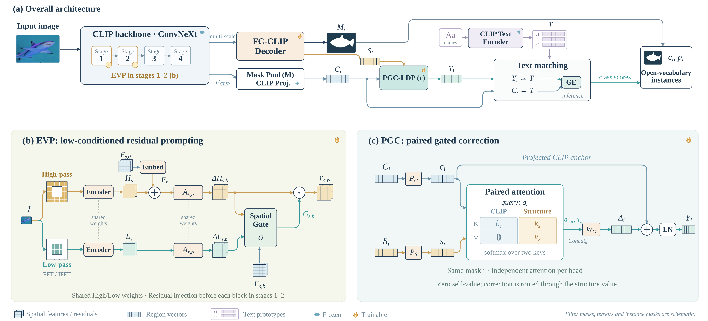

# OVS-FCCLIP Overview

最新版模型总览（v5）：整体流程简写，EVP 与 PGC 核心机制展开。

## 查看与下载

- [高清 PNG](OVS_FCCLIP_overview_v5.png)
- [矢量 PDF](OVS_FCCLIP_overview_v5.pdf)
- [可编辑 SVG](OVS_FCCLIP_overview_v5.svg)

图中包含整体架构、低频条件控制的 EVP 残差提示，以及配对门控校正 PGC。输入图像为示意；频域滤波遮罩、特征张量与实例掩码均为机制示意，不代表实验预测结果。

The overview corresponds to the PGC + high/low-frequency EVP configuration with residual injection in stages 1–2. Its implementation reference is commit `c5ff07d9beab32c627eb8ded7c4f312b7c1e4517`.
