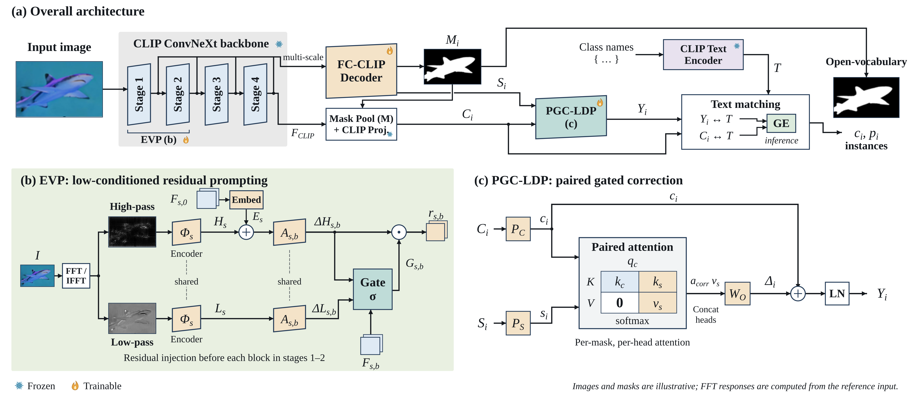

# OVS-FCCLIP Overview

最新版模型总览（v7）：参考论文方法图的模块形态、数据示例与信息密度，重画整体架构及 EVP / PGC 局部机制。

## 查看与下载

- [高清 PNG（5000 × 2175）](OVS_FCCLIP_overview_v7.png)
- [矢量 PDF](OVS_FCCLIP_overview_v7.pdf)
- [可编辑 SVG](OVS_FCCLIP_overview_v7.svg)

## v7 的主要变化

- 用参考图中的鲨鱼轮廓替换通用鱼类图标，保留原图边缘的灰度。
- 用从参考输入计算的高低频响应替换彩色棋盘格，保留它们作为图像数据的视觉形态。
- 主干采用紧凑的窄网络模块，取消按钮式 Stage、分图徽章和结果卡片。
- 中间变量直接使用数学符号，空间特征仅在关键位置使用薄片示意，减少重复的格子图标。
- 使用黑色直角数据流与更清楚的算子层级；显式画出四阶段的多尺度输出、掩码池化支路及 PGC 的残差路径。

## 图示来源与含义

输入图像与展示用掩码取自用户提供的参考图，均为机制示意。掩码不是 OVS-FCCLIP 的预测结果。

高低频面板由参考输入的 104 × 67 RGB 裁图计算：按仓库使用的 CLIP mean / std 归一化，使用 `FREQ_RATE = 0.25` 的中心方形 FFT 滤波，逆变换后取实部绝对值，再以通道均值和逐面板线性强度缩放显示。它们是滤波响应示意，不是训练后的 prompt、feature 或 gate 激活。此示意未复现完整推理的 resize 与 batch padding。

Implementation reference: `c5ff07d9beab32c627eb8ded7c4f312b7c1e4517`, using the PGC + high/low-frequency EVP configuration with residual injection in stages 1–2. The filter follows `fcclip/modeling/backbone/evp_prompter.py`.

**Suggested caption note:** Input and mask examples are reproduced from the supplied reference figure. FFT responses are computed from the reference input and rescaled for visualization; they are not model predictions or learned activations.

## 上一版

[v6 PNG](OVS_FCCLIP_overview_v6.png) · [v6 PDF](OVS_FCCLIP_overview_v6.pdf) · [v6 SVG](OVS_FCCLIP_overview_v6.svg)

[v5 PNG](OVS_FCCLIP_overview_v5.png) · [v5 PDF](OVS_FCCLIP_overview_v5.pdf) · [v5 SVG](OVS_FCCLIP_overview_v5.svg)
