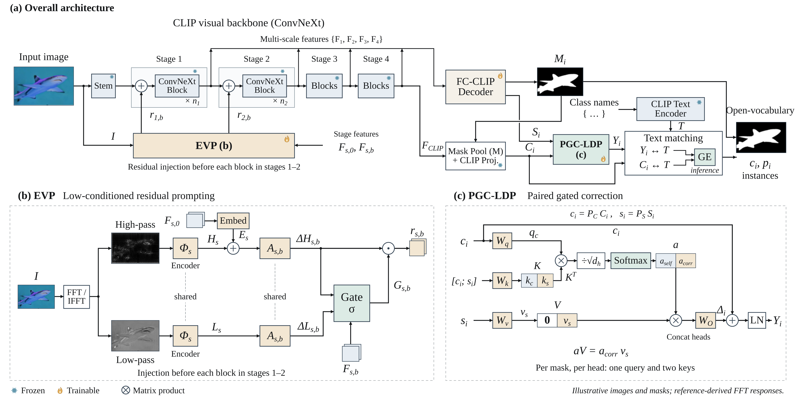

# OVS-FCCLIP Overview

最新版：v10，PNG 格式。上方按 FC-CLIP 的共享主干和原始 EVP 的注入关系重排：Stage 1–2 明确展示逐 block 的残差加法，EVP 作为独立可训练侧支，四级多尺度输出与最终 CLIP 密集特征分别连接到 decoder 和 mask pooling。

[查看或下载高清 PNG（6000 × 3015）](OVS_FCCLIP_overview_v10.png)

## CLIP 与 EVP 的组织参考

以下原始论文图均已实际查看，页码为 PDF 文件页码。参考的是信息层级、旁支位置与注入表达；OVS-FCCLIP 的连接关系以本仓库实现为准。

| 原始论文 | 图与 PDF 页码 | 本图借鉴的表达 |
|---|---|---|
| [FC-CLIP / Convolutions Die Hard, NeurIPS 2023](https://arxiv.org/pdf/2308.02487#page=5) | Fig. 3，第 5 页 | 一套 CLIP 视觉主干，分别服务多尺度解码与 CLIP 特征的 mask pooling。 |
| [Explicit Visual Prompting for Low-Level Structure Segmentations, CVPR 2023](https://openaccess.thecvf.com/content/CVPR2023/papers/Liu_Explicit_Visual_Prompting_for_Low-Level_Structure_Segmentations_CVPR_2023_paper.pdf#page=4) | Fig. 3，第 4 页 | 提示生成侧支与冻结主干分离，提示明确接到层前的加法节点。 |
| [Side Adapter Network for Open-Vocabulary Semantic Segmentation, CVPR 2023](https://openaccess.thecvf.com/content/CVPR2023/papers/Xu_Side_Adapter_Network_for_Open-Vocabulary_Semantic_Segmentation_CVPR_2023_paper.pdf#page=2) | Fig. 2，第 2 页 | 冻结主干与可训练旁支上下对齐，交互位置通过真实连线表达。 |
| [AdaptFormer, NeurIPS 2022](https://papers.nips.cc/paper_files/paper/2022/file/69e2f49ab0837b71b0e0cb7c555990f8-Paper-Conference.pdf#page=4) | Fig. 2(b)，第 4 页 | 用一个重复单元及次数标记概括主干，局部机制另行展开。 |

辅助参考：[Visual Prompt Tuning, ECCV 2022，Fig. 2，第 4 页](https://www.ecva.net/papers/eccv_2022/papers_ECCV/papers/136930696.pdf#page=4)。本图使用加性空间残差，不采用 VPT 的 token 拼接，也不采用 SAN 的 mask/attention-bias 旁支或 AdaptFormer 的 FFN 并联位置。

### 上方总览的接口与省略项

- 图像只经过一套 CLIP ConvNeXt 视觉主干。Stem、原始 blocks、文本编码器与 CLIP visual projection 的权重冻结；EVP 是可训练模块。
- Stage 1、2 的框包含 `add → ConvNeXt block`，分别重复 `n_1`、`n_2` 次：`F_{s,b+1} = Block_{s,b}(F_{s,b} + r_{s,b})`。Stage 3、4 无 EVP 注入，概括为普通 blocks。
- EVP 的 `F_{s,0}` 是该 stage 下采样后的入口特征，用于一次性的 stage embedding；`F_{s,b}` 是当前 block 的输入特征，用于该 block 的门控。图中统一作为 Stage features 接口，具体依赖在 (b) 展开。
- 四个 stage 的输出 `F_1…F_4` 对应实现中的 `res2…res5`，汇为多尺度特征供 decoder 使用；`F_CLIP` 是最后一级经 `norm_pre` 后的 `clip_vis_dense`，供预测 masks 的 pooling 使用。
- 总览省略 stage 下采样、`norm_pre` 和 ConvNeXt block 内部卷积细节；`n_s` 只表示该 stage 的 block 数量，不表示重复执行下采样。
- 冻结标记表示参数不更新，不表示停止梯度，也不表示 EVP 注入后的中间特征保持不变。

Implementation: [CLIP backbone](../../fcclip/modeling/backbone/clip.py) · [EVP generator](../../fcclip/modeling/backbone/evp_prompter.py).

## QKV 绘图参考

以下图号与 PDF 页码均已逐图核对。借鉴的是计算关系和版面组织，不把参考论文的模型组件移入 OVS-FCCLIP。

| 原始论文 | 图与 PDF 页码 | 本图借鉴的表达 |
|---|---|---|
| [CrossViT: Cross-Attention Multi-Scale Vision Transformer for Image Classification, ICCV 2021](https://arxiv.org/pdf/2103.14899#page=5) | Fig. 4，第 5 页 | 单 query、Q/K/V 投影、value 旁路与残差的清楚分工。 |
| [Restormer: Efficient Transformer for High-Resolution Image Restoration, CVPR 2022](https://openaccess.thecvf.com/content/CVPR2022/papers/Zamir_Restormer_Efficient_Transformer_for_High-Resolution_Image_Restoration_CVPR_2022_paper.pdf#page=3) | Fig. 2(a)，第 3 页右下 | 整体架构与机制展开；Q/K 权重计算、V 聚合的两次矩阵乘法。 |
| [Attention Is All You Need, NeurIPS 2017](https://papers.nips.cc/paper/7181-attention-is-all-you-need.pdf#page=4) | Fig. 2，第 4 页 | Scaled dot-product attention、head 拼接与输出投影的标准计算顺序。 |
| [Non-local Neural Networks, CVPR 2018](https://arxiv.org/pdf/1711.07971#page=3) | Fig. 2，第 3 页 | 用少量投影框、矩阵乘和残差支路表达注意力；其 θ/φ/g 分支对应 Q/K/V 式的角色。 |

## PGC 的专属语义

- `c_i = P_C C_i`，`s_i = P_S S_i`。
- Query 只来自 `c_i`；共享 key 投影处理 `[c_i; s_i]`，形成两个 key。
- Value 为 `[0; v_s]`，其中 `v_s = W_v s_i`。零值在 value 分支；self key 仍参与两项 Softmax。
- 每个 mask、每个 head 独立计算；图中两项权重不是全图空间或通道注意力矩阵。
- 聚合后拼接 heads，经输出投影，再与投影后的 `c_i` 相加并经过 LN。
- 图示核心推理计算；训练期 Dropout 等细节省略。

PGC implementation: [fcclip/modeling/local_discriminative_pooling.py](../../fcclip/modeling/local_discriminative_pooling.py).

## 图像示例说明

输入图像和展示用掩码取自提供的参考图。高低频面板由同一参考输入裁图按仓库的 CLIP 归一化及 FFT 滤波算子（`FREQ_RATE = 0.25`）计算，并作灰度强度缩放显示。它们用于说明机制，不代表 OVS-FCCLIP 的实际预测或训练后激活。

Implementation reference: `c5ff07d9beab32c627eb8ded7c4f312b7c1e4517`, using the PGC + high/low-frequency EVP configuration with residual injection in stages 1–2.

## 旧版 PNG

[v9](OVS_FCCLIP_overview_v9.png) · [v8](OVS_FCCLIP_overview_v8.png) · [v7](OVS_FCCLIP_overview_v7.png) · [v6](OVS_FCCLIP_overview_v6.png)
