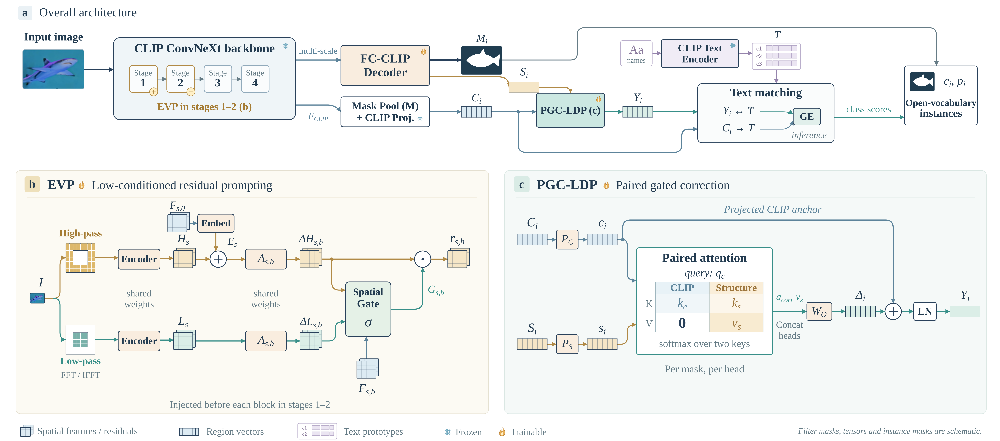

# OVS-FCCLIP Overview

最新版模型总览（v6）：上方概括整体架构，下方展开 EVP 与 PGC 核心机制。

## 查看与下载

- [高清 PNG（5000 × 2205）](OVS_FCCLIP_overview_v6.png)
- [矢量 PDF](OVS_FCCLIP_overview_v6.pdf)
- [可编辑 SVG](OVS_FCCLIP_overview_v6.svg)

## 本版视觉调整

- 收紧上下区域的留白，统一分图编号、标题层级、模块间距和连线样式。
- 使用低饱和蓝、金、青和淡紫区分信号类型，并以浅色底区分两个机制面板。
- 以叠层二维网格、单行向量和多行原型矩阵分别表示空间特征、区域向量和文本原型。
- 统一同类向量尺寸；强化 PGC 配对表中零 self-value 与结构 value 的对照，增加输出链的空间。

图中包含整体架构、低频条件控制的 EVP 残差提示，以及配对门控校正 PGC。输入图像为示意；频域滤波遮罩、特征张量与实例掩码均为机制示意，不代表实验预测结果。

The overview corresponds to the PGC + high/low-frequency EVP configuration with residual injection in stages 1–2. Its implementation reference is commit `c5ff07d9beab32c627eb8ded7c4f312b7c1e4517`.

## 上一版

[v5 PNG](OVS_FCCLIP_overview_v5.png) · [v5 PDF](OVS_FCCLIP_overview_v5.pdf) · [v5 SVG](OVS_FCCLIP_overview_v5.svg)
