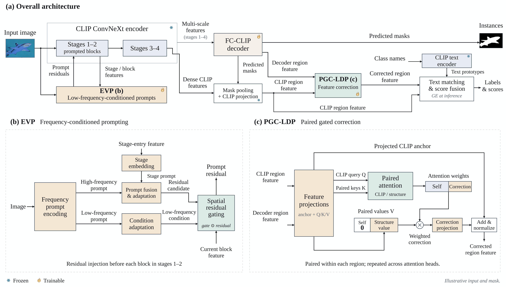

# OVS-FCCLIP Overview

最新版：**v12**，使用语义标签与功能分组呈现模型。图中的区域表示直接标为 **CLIP region feature**、**Decoder region feature** 与 **Corrected region feature**；连续完成同一功能的实现步骤合并为模块，关键依赖仍单独保留。

[查看或下载高清 PNG（6000 × 3409）](OVS_FCCLIP_overview_v12.png)

## v12 的命名方式

| v11 标注 | v12 标签 | 表示的内容 |
| --- | --- | --- |
| `F_CLIP` | Dense CLIP features | 最末级经 norm_pre 的密集视觉特征，用于预测 mask 的区域池化。 |
| `C_i` | CLIP region feature | 对预测区域池化后，再经过冻结 CLIP visual heads 的区域语义表示。 |
| `S_i` | Decoder region feature | 来自 decoder 的区域表示，包含池化投影与归一化查询特征。 |
| `Y_i` | Corrected region feature | PGC 输出的区域分类表示。 |
| PGC 内的 `c_i` | Projected CLIP anchor | 经可训练 anchor projection 后的 CLIP 表示，独立进入残差路径。 |
| `M_i` | Predicted masks | 分割解码器产生的候选 masks。 |
| `T` | Text prototypes | 类别文本编码后用于匹配的原型。 |
| 最终 `c_i, p_i` | Labels & scores | 最终实例的类别与置信度，避免与 PGC 内的锚点记号重名。 |
| `r_{s,b}` | Prompt residual | 实际注入主干 block 之前的、已经过门控的提示残差。 |
| `ΔH_{s,b}` | Residual candidate | 高频提示与 stage embedding 融合并适配后形成的候选残差。 |
| `ΔL_{s,b}` | Low-frequency condition | 仅用于调节 gate 的低频条件。 |

总览使用 **region feature**，突出表示与预测区域的对应关系；投影后的 PGC 旁路才使用 **anchor**。Q、K、V 仅在注意力局部保留，用来区分 query、keys 和 values 的计算角色。

## v12 的功能分组

### 主干与分类

- Stem 与 block 内部结构收进 CLIP ConvNeXt encoder；Stage 1–2 与 Stage 3–4 分组显示。
- 多尺度特征由编码器整体的输出接口表示，并明确标为 stages 1–4；这仍然包含四个 stage 的输出。
- Stage 1–2 的提示与阶段特征接口分别保留。残差在每个 block 前注入，不是只在两个 stage group 的入口加一次。
- 两路文本相似度计算与几何集成合成 **Text matching & score fusion**。原始 CLIP region feature 的独立分类旁路仍然保留，GE 仍只用于推理。

### EVP

| 合并后模块 | 包含的计算 |
| --- | --- |
| Frequency prompt encoding | 高低频滤波、逆变换、响应处理与对应层级提示编码。 |
| Stage embedding | 从 stage 入口特征生成该 stage 复用的嵌入提示。 |
| Prompt fusion & adaptation | 高频提示与 stage embedding 相加，再经 adaptor 生成残差候选。 |
| Condition adaptation | 低频提示经 adaptor 形成门控条件。 |
| Spatial residual gating | 条件门控网络、sigmoid 与残差逐元素缩放，输出 Prompt residual。 |

高低频两路仍共享对应的提示编码器；固定 stage/block 下仍复用同一 adaptor，但“高频融合与适配”整框包含额外加法，不能把该整框与低频条件框解释为完全相同的算子。共享注释和内部线性层从主图中收起。

### PGC

| 合并后模块 | 包含的计算 |
| --- | --- |
| Feature projections | CLIP/structure 两路输入投影，以及 Q、K、V 的投影；另输出投影后的 CLIP anchor。 |
| Paired attention | Query 对两个 keys 的点积、按单头维度缩放和两项 softmax。 |
| Correction projection | 多头校正拼接及输出投影。 |
| Add & normalize | 投影后的 anchor 与校正残差相加，再做 LayerNorm。 |

**保留的专属机制：**

- Query 来自 CLIP；两个 keys 来自同一区域的 CLIP 与 structure 表示。
- Paired values 明确显示 **Self = 0** 和 **Structure value**；结构 value 从对应槽进入。零 self-value 在 value projection 之后设置，self key 仍参与注意力竞争。
- Projected CLIP anchor 从 Feature projections 输出引出，独立进入残差路径，不乘 Self attention weight。
- PGC 输出是区域分类特征；mask 输出绕过 PGC。
- 计算在每个区域、每个 attention head 内进行；图中两个权重不是类别概率，也不是跨所有 masks 的注意力。

## 简化范围与实现依据

v12 收起了重复雪花、重复次数、stage 内部算子、FFT 过程与频率示例缩略图、频率中间量符号、单个投影矩阵、缩放和 Softmax 独立小框，以及 tensor 叠片。主图以功能粒度说明方法；图中模块合并不表示代码删除了相应步骤。

源代码固定参考 `3190e4cbd00f4957534df363f2c4e5ae11e787c9`：

- [CLIP backbone 与逐块提示注入](https://github.com/GU1204/OVS-FCCLIP/blob/3190e4cbd00f4957534df363f2c4e5ae11e787c9/fcclip/modeling/backbone/clip.py)
- [EVP 提示与门控](https://github.com/GU1204/OVS-FCCLIP/blob/3190e4cbd00f4957534df363f2c4e5ae11e787c9/fcclip/modeling/backbone/evp_prompter.py)
- [PGC](https://github.com/GU1204/OVS-FCCLIP/blob/3190e4cbd00f4957534df363f2c4e5ae11e787c9/fcclip/modeling/local_discriminative_pooling.py)
- [分类、GE 与实例后处理](https://github.com/GU1204/OVS-FCCLIP/blob/3190e4cbd00f4957534df363f2c4e5ae11e787c9/fcclip/fcclip.py)

输入图与 mask 画面沿用用户提供的参考素材，仅用于展示，不是 OVS-FCCLIP 的实测输出。v12 已移除频率响应缩略图。

## v11 的详细组件说明

此前的完整说明对应 **v11 的符号与布局**。其真实计算、源码解释仍可参考；v12 的标签对应关系以本文上表为准。

[在线阅读 v11 组件说明](OVS_FCCLIP_overview_v11_guide.md) · [下载 v11 Word 说明](OVS_FCCLIP_overview_v11_guide.docx)

## 历史 PNG

[v11](OVS_FCCLIP_overview_v11.png) · [v10](OVS_FCCLIP_overview_v10.png) · [v9](OVS_FCCLIP_overview_v9.png) · [v8](OVS_FCCLIP_overview_v8.png) · [v7](OVS_FCCLIP_overview_v7.png) · [v6](OVS_FCCLIP_overview_v6.png)

展开 v11 的绘图记录与论文参考

## v11 的布局整理

- 只保留最终输出位置的一张 mask 示例，decoder 到该输出使用直线路径。
- `M_i` 同时标在 decoder 的 mask 输出线上及 Mask Pool 上方短输入端：两处代表同一个预测 mask，用同名接口省略跨区域返回连线，pooling 的 mask 依赖保留。
- `C_i` 的独立匹配旁路紧贴 PGC 下沿，`Y_i` 仍直接送往文本匹配。
- EVP 的 `F_{s,0}, F_{s,b}` 接口移至两条 residual 注入线之间；Stage 1–2 的加法位置与重复次数保留。
- 多尺度特征的四个来源保留为细线 taps，仅在进入 decoder 的出口显示箭头。主干标题已标明 ConvNeXt，重复单元内简写为 Block。
- 下方 EVP 和 PGC 的内部计算保持 v10 的表达；原始论文参考与接口说明见下文。

## CLIP 与 EVP 的组织参考

以下原始论文图均已实际查看，页码为 PDF 文件页码。参考的是信息层级、旁支位置与注入表达；OVS-FCCLIP 的连接关系以本仓库实现为准。

| 原始论文 | 图与 PDF 页码 | 本图借鉴的表达 |
|---|---|---|
| [FC-CLIP / Convolutions Die Hard, NeurIPS 2023](https://arxiv.org/pdf/2308.02487#page=5) | Fig. 3，第 5 页 | 一套 CLIP 视觉主干，分别服务多尺度解码与 CLIP 特征的 mask pooling。 |
| [Explicit Visual Prompting for Low-Level Structure Segmentations, CVPR 2023](https://openaccess.thecvf.com/content/CVPR2023/papers/Liu_Explicit_Visual_Prompting_for_Low-Level_Structure_Segmentations_CVPR_2023_paper.pdf#page=4) | Fig. 3，第 4 页 | 提示生成侧支与冻结主干分离，提示明确接到层前的加法节点。 |
| [Side Adapter Network for Open-Vocabulary Semantic Segmentation, CVPR 2023](https://openaccess.thecvf.com/content/CVPR2023/papers/Xu_Side_Adapter_Network_for_Open-Vocabulary_Semantic_Segmentation_CVPR_2023_paper.pdf#page=2) | Fig. 2，第 2 页 | 冻结主干与可训练旁支上下对齐，交互位置通过真实连线表达。 |
| [AdaptFormer, NeurIPS 2022](https://papers.nips.cc/paper_files/paper/2022/file/69e2f49ab0837b71b0e0cb7c555990f8-Paper-Conference.pdf#page=4) | Fig. 2(b)，第 4 页 | 用一个重复单元及次数标记概括主干，局部机制另行展开。 |

辅助参考：[Visual Prompt Tuning, ECCV 2022，Fig. 2，第 4 页](https://www.ecva.net/papers/eccv_2022/papers_ECCV/papers/136930696.pdf#page=4)。本图使用加性空间残差，不采用 VPT 的 token 拼接，也不采用 SAN 的 mask/attention-bias 旁支或 AdaptFormer 的 FFN 并联位置。

### 上方总览的接口与省略项

- 图像只经过一套 CLIP ConvNeXt 视觉主干。Stem、原始 blocks、文本编码器与 CLIP visual projection 的权重冻结；EVP 是可训练模块。
- Stage 1、2 的框包含 `add → ConvNeXt block`，分别重复 `n_1`、`n_2` 次：`F_{s,b+1} = Block_{s,b}(F_{s,b} + r_{s,b})`。Stage 3、4 无 EVP 注入，概括为普通 blocks。
- EVP 的 `F_{s,0}` 是该 stage 下采样后的入口特征，用于一次性的 stage embedding；`F_{s,b}` 是当前 block 的输入特征，用于该 block 的门控。图中以阶段特征的同名符号入口表示，具体依赖在 (b) 展开。
- 四个 stage 的输出 `F_1…F_4` 对应实现中的 `res2…res5`，汇为多尺度特征供 decoder 使用；`F_CLIP` 是最后一级经 `norm_pre` 后的 `clip_vis_dense`，供预测 masks 的 pooling 使用。
- 总览省略 stage 下采样、`norm_pre` 和 ConvNeXt block 内部卷积细节；`n_s` 只表示该 stage 的 block 数量，不表示重复执行下采样。
- 冻结标记表示参数不更新，不表示停止梯度，也不表示 EVP 注入后的中间特征保持不变。

Implementation: [CLIP backbone](../../fcclip/modeling/backbone/clip.py) · [EVP generator](../../fcclip/modeling/backbone/evp_prompter.py).

## QKV 绘图参考

以下图号与 PDF 页码均已逐图核对。借鉴的是计算关系和版面组织，不把参考论文的模型组件移入 OVS-FCCLIP。

| 原始论文 | 图与 PDF 页码 | 本图借鉴的表达 |
|---|---|---|
| [CrossViT: Cross-Attention Multi-Scale Vision Transformer for Image Classification, ICCV 2021](https://arxiv.org/pdf/2103.14899#page=5) | Fig. 4，第 5 页 | 单 query、Q/K/V 投影、value 旁路与残差的清楚分工。 |
| [Restormer: Efficient Transformer for High-Resolution Image Restoration, CVPR 2022](https://openaccess.thecvf.com/content/CVPR2022/papers/Zamir_Restormer_Efficient_Transformer_for_High-Resolution_Image_Restoration_CVPR_2022_paper.pdf#page=3) | Fig. 2(a)，第 3 页右下 | 整体架构与机制展开；Q/K 权重计算、V 聚合的两次矩阵乘法。 |
| [Attention Is All You Need, NeurIPS 2017](https://papers.nips.cc/paper/7181-attention-is-all-you-need.pdf#page=4) | Fig. 2，第 4 页 | Scaled dot-product attention、head 拼接与输出投影的标准计算顺序。 |
| [Non-local Neural Networks, CVPR 2018](https://arxiv.org/pdf/1711.07971#page=3) | Fig. 2，第 3 页 | 用少量投影框、矩阵乘和残差支路表达注意力；其 θ/φ/g 分支对应 Q/K/V 式的角色。 |

## PGC 的专属语义

- `c_i = P_C C_i`，`s_i = P_S S_i`。
- Query 只来自 `c_i`；共享 key 投影处理 `[c_i; s_i]`，形成两个 key。
- Value 为 `[0; v_s]`，其中 `v_s = W_v s_i`。零值在 value 分支；self key 仍参与两项 Softmax。
- 每个 mask、每个 head 独立计算；图中两项权重不是全图空间或通道注意力矩阵。
- 聚合后拼接 heads，经输出投影，再与投影后的 `c_i` 相加并经过 LN。
- 图示核心推理计算；训练期 Dropout 等细节省略。

PGC implementation: [fcclip/modeling/local_discriminative_pooling.py](../../fcclip/modeling/local_discriminative_pooling.py).

## 图像示例说明

输入图像和展示用掩码取自提供的参考图。高低频面板由同一参考输入裁图按仓库的 CLIP 归一化及 FFT 滤波算子（`FREQ_RATE = 0.25`）计算，并作灰度强度缩放显示。它们用于说明机制，不代表 OVS-FCCLIP 的实际预测或训练后激活。

Implementation reference: `c5ff07d9beab32c627eb8ded7c4f312b7c1e4517`, using the PGC + high/low-frequency EVP configuration with residual injection in stages 1–2.

