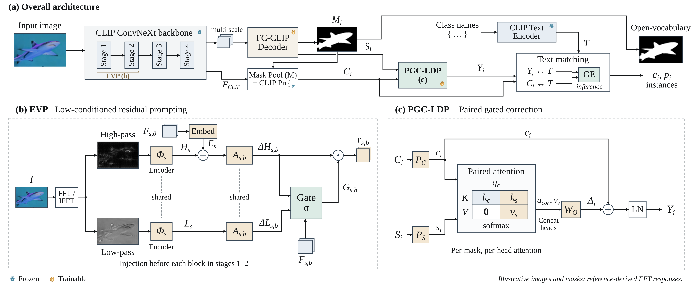

# OVS-FCCLIP Overview

最新版：v8，论文方法图风格，PNG 格式。

## 高清图

[查看或下载 PNG（6000 × 2490）](OVS_FCCLIP_overview_v8.png)

本版采用紧凑的整体架构和两块机制展开：上方概括 CLIP、FC-CLIP decoder、PGC 与文本匹配；下方展开低频条件控制的 EVP 残差提示，以及 PGC 的配对注意力与残差校正。字体、模块边框和连线使用统一层级，多尺度输出以特征组简写。

## 图示说明

输入图像和展示用掩码取自提供的参考图。高低频面板由同一参考输入裁图按仓库的 CLIP 归一化及 FFT 滤波算子（`FREQ_RATE = 0.25`）计算，并作灰度强度缩放显示。图中样例用于说明机制，不代表 OVS-FCCLIP 的实际预测或训练后激活。

Implementation reference: `c5ff07d9beab32c627eb8ded7c4f312b7c1e4517`, using the PGC + high/low-frequency EVP configuration with residual injection in stages 1–2.

## 旧版 PNG

[v7](OVS_FCCLIP_overview_v7.png) · [v6](OVS_FCCLIP_overview_v6.png) · [v5](OVS_FCCLIP_overview_v5.png)
