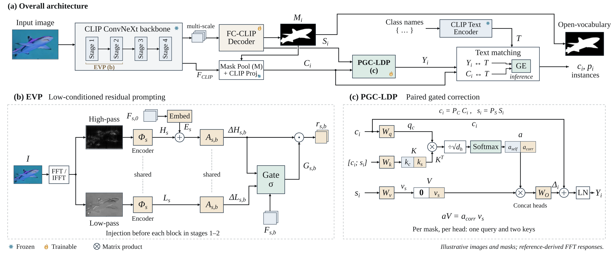

# OVS-FCCLIP Overview

最新版：v9，PNG 格式。PGC 局部图参考原始 QKV 论文的算子图表达，显式展示投影、两次矩阵乘法、Softmax、value 聚合与残差。

[查看或下载高清 PNG（6000 × 2490）](OVS_FCCLIP_overview_v9.png)

## QKV 绘图参考

以下图号与 PDF 页码均已逐图核对。借鉴的是计算关系和版面组织，不把参考论文的模型组件移入 OVS-FCCLIP。

| 原始论文 | 图与 PDF 页码 | 本图借鉴的表达 |
|---|---|---|
| [CrossViT: Cross-Attention Multi-Scale Vision Transformer for Image Classification, ICCV 2021](https://arxiv.org/pdf/2103.14899#page=5) | Fig. 4，第 5 页 | 单 query、Q/K/V 投影、value 旁路与残差的清楚分工。 |
| [Restormer: Efficient Transformer for High-Resolution Image Restoration, CVPR 2022](https://openaccess.thecvf.com/content/CVPR2022/papers/Zamir_Restormer_Efficient_Transformer_for_High-Resolution_Image_Restoration_CVPR_2022_paper.pdf#page=3) | Fig. 2(a)，第 3 页右下 | 整体架构与机制展开；Q/K 权重计算、V 聚合的两次矩阵乘法。 |
| [Attention Is All You Need, NeurIPS 2017](https://papers.nips.cc/paper/7181-attention-is-all-you-need.pdf#page=4) | Fig. 2，第 4 页 | Scaled dot-product attention、head 拼接与输出投影的标准计算顺序。 |
| [Non-local Neural Networks, CVPR 2018](https://arxiv.org/pdf/1711.07971#page=3) | Fig. 2，第 3 页 | 用少量投影框、矩阵乘和残差支路表达注意力；其 θ/φ/g 分支对应 Q/K/V 式的角色。 |

## PGC 的专属语义

- `c_i = P_C C_i`，`s_i = P_S S_i`。
- Query 只来自 `c_i`；共享 key 投影处理 `[c_i; s_i]`，形成两个 key。
- Value 为 `[0; v_s]`，其中 `v_s = W_v s_i`。零值在 value 分支；self key 仍参与两项 Softmax。
- 每个 mask、每个 head 独立计算；图中两项权重不是全图空间或通道注意力矩阵。
- 聚合后拼接 heads，经输出投影，再与投影后的 `c_i` 相加并经过 LN。
- 图示核心推理计算；训练期 Dropout 等细节省略。

PGC implementation: [fcclip/modeling/local_discriminative_pooling.py](../../fcclip/modeling/local_discriminative_pooling.py).

## 图像示例说明

输入图像和展示用掩码取自提供的参考图。高低频面板由同一参考输入裁图按仓库的 CLIP 归一化及 FFT 滤波算子（`FREQ_RATE = 0.25`）计算，并作灰度强度缩放显示。它们用于说明机制，不代表 OVS-FCCLIP 的实际预测或训练后激活。

Implementation reference: `c5ff07d9beab32c627eb8ded7c4f312b7c1e4517`, using the PGC + high/low-frequency EVP configuration with residual injection in stages 1–2.

## 旧版 PNG

[v8](OVS_FCCLIP_overview_v8.png) · [v7](OVS_FCCLIP_overview_v7.png) · [v6](OVS_FCCLIP_overview_v6.png)
